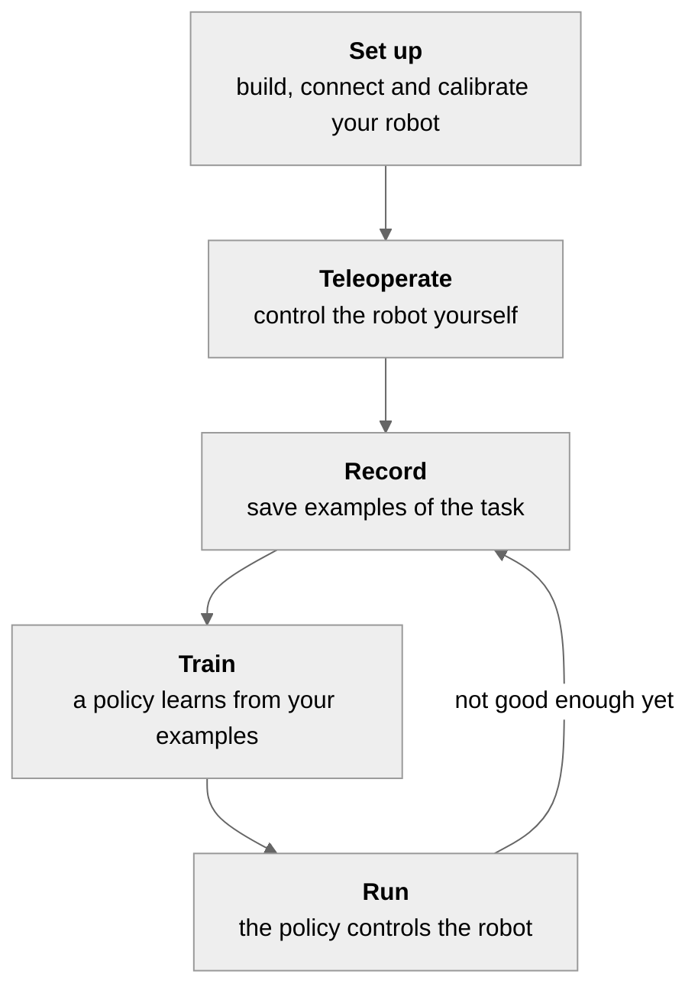
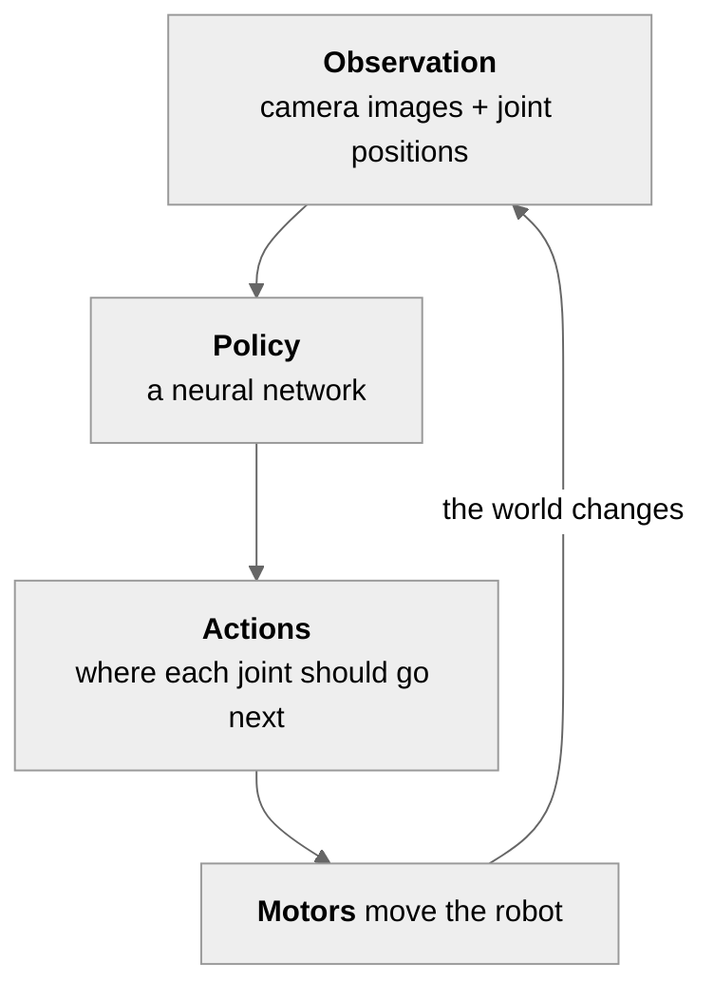

# How robot learning works

LeRobot teaches a robot a new skill by example: you show it a task a few dozen times, and it learns to do the task on its own. This page explains how that works and the handful of words you will meet everywhere in these docs. It takes about five minutes to read.

## The loop

1. **Set up:** build or unbox your robot, connect it to your computer and calibrate it.
2. **Teleoperate:** control the robot yourself, live, usually by moving a second arm with your hand.
3. **Record:** do the task a few dozen times while LeRobot records the cameras and the robot's movements.
4. **Train:** a neural network, the **policy**, learns to copy what you did.
5. **Run:** the policy controls the robot and does the task on its own. If it doesn't succeed often enough, you record more or better examples and train again.

The [step-by-step tutorial](./il_robots) walks you through each of these steps with your own robot. Each step has one command: `lerobot-teleoperate`, `lerobot-record`, `lerobot-train` and `lerobot-rollout`.

## Your setup

  
  

- **The robot**, or **follower arm**: the robot that does the task. Left, the SO-101.
- **A teleoperation device**: what you control the robot with while recording. Most often a **leader arm** (right): a copy of the robot that you move by hand, and the follower copies every move. A keyboard, gamepad, phone or VR headset also works for some robots (see [Teleoperation devices](./teleoperators)).
- **One or two cameras**: usually one looking at the scene and one on the robot's wrist. The policy sees the world only through them.
- **A computer** connected to the robot, and **a GPU** to train on: your own, a free Google Colab notebook, or a rented one on Hugging Face Jobs (see [Which GPU do I need?](./hardware_guide)).

> [!TIP]
> **Do I need two arms?** You need some way to control the robot while you record, and a leader arm is the easiest one. You don't need it to run a policy that is already trained.

**Calibration** is a one-time step for each arm: you move every joint through its full range so LeRobot knows where each motor's limits are. After that, the leader and the follower agree on what each position means, so the follower copies the leader exactly. The calibration is saved under the arm's **ID** (for example `my_follower`), which is why you give the same ID in every command.

## What gets recorded

While you teleoperate, LeRobot saves what happens 30 times per second. Each of these moments is a **frame**, and holds two things:

- the **observation**: what the robot senses. The camera images, plus its **state**: the position of every joint.
- the **action**: the command sent to the motors at that moment, which is where you moved the leader arm.

One recording of the task, from start to end, is an **episode**. Many episodes of the same task make a **dataset**. Datasets live on the [Hugging Face Hub](https://huggingface.co/datasets?other=LeRobot), where you can share yours and use thousands recorded by others.

  

An episode in the [Dataset Visualizer](https://huggingface.co/spaces/lerobot/visualize_dataset): what the cameras saw, and below, the state and actions of every joint over time.

## What a policy is

A **policy** is the AI model that controls your robot. Many times per second, it looks at the latest observation and decides the next actions:

Most policies predict a short sequence of future actions at once, an **action chunk** (for example the next 100 actions for ACT), which makes the movements smoother.

**Training** shows the policy the frames of your dataset again and again, until its actions match yours. During training, LeRobot saves **checkpoints**: copies of the policy at different points, so you can run the latest or go back to an earlier one. You can train a policy **from scratch**, or **fine-tune** one that was already trained on large datasets, which needs less of your own data.

### Kinds of policies

| Kind                                     | What it is                                                                                      | Good for                                                    |
| ---------------------------------------- | ----------------------------------------------------------------------------------------------- | ----------------------------------------------------------- |
| **Small imitation-learning models**      | Small, fast policies trained from scratch on your data. [ACT](./act) is the usual first choice. | One task, a gaming GPU or a free Colab GPU. **Start here.** |
| **Vision-language-action models (VLAs)** | Large pretrained policies that also read a text instruction, like "put the cube in the box".    | Several tasks, following instructions. Need a larger GPU.   |
| **World action models (WAMs)**           | Policies that predict the next camera frames as well as the actions.                            | Research. Need large GPUs.                                  |

[Choose a policy](./policies) compares all of them and tells you which one to start with.

## Ways to teach a robot

Learning from your examples is the main way, and the one the tutorial follows. The others build on it.

| Approach                                  | How the robot learns                                                                    | Use it when                                                                |
| ----------------------------------------- | --------------------------------------------------------------------------------------- | -------------------------------------------------------------------------- |
| **Imitation learning**                    | It copies the episodes you recorded.                                                    | You can show the task. This is where everyone starts.                      |
| **Human corrections** (human-in-the-loop) | The policy runs, you take over when it goes wrong, and it learns from your corrections. | Your policy mostly works but fails in a few situations.                    |
| **Reinforcement learning** (RL)           | It tries the task on its own and learns from a reward that says how well it did.        | You need very high reliability on one task and can set up a reward.        |
| **Simulation**                            | Everything happens in software, with a simulated robot.                                 | You don't have a robot yet, or you want to compare policies on benchmarks. |

A policy trained in simulation won't run on your real robot as is: the simulated robot, cameras and world are too different. Simulation is for learning, testing ideas and benchmarking. See [Simulation: when and why](./simulation_overview).

## Next steps

- **You have a robot:** start the [step-by-step tutorial](./il_robots).
- **You don't have one yet:** [try LeRobot without a robot](./quickstart), or [choose a robot](./robots).
- **You found a word you don't know:** it's in the [Glossary](./glossary).
