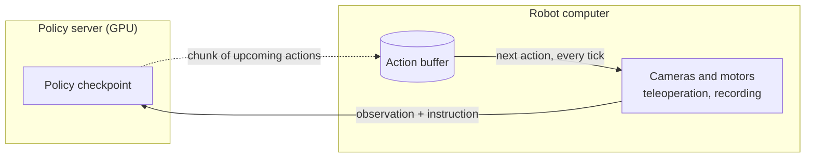
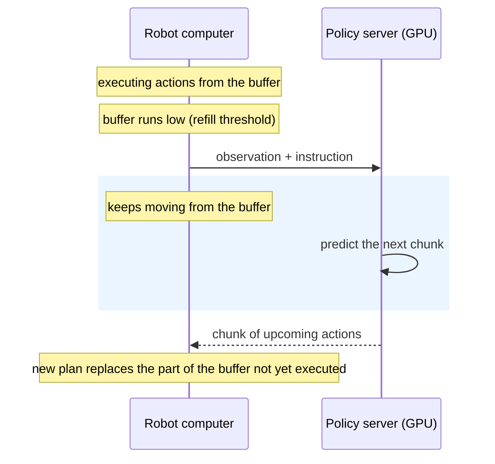

# Remote Inference

Large policies need a GPU, and with a synchronous rollout the robot stops moving every time the policy computes its next chunk of actions. Remote inference splits the job in two: a **policy server** runs the checkpoint on a GPU, and the **robot computer** keeps control of cameras, motors, teleoperation and recording. The robot keeps executing the actions it already has while the server computes the next ones, so motion no longer pauses for inference.

Use it when:

- the computer wired to the robot has no GPU, or one too small for the policy: a laptop or single-board computer next to the arm and a GPU workstation across the lab;
- inference takes a noticeable fraction of each action chunk and you want continuous motion;
- you want to decide how often the robot replans without touching the checkpoint.

The one tradeoff you tune is **freshness versus continuity**. Asking for a new plan sooner lets the robot react to what it sees; following more of the current plan preserves task progress.

## How it works



The robot computer keeps a buffer of upcoming actions. When the buffer runs low it sends a fresh observation, keeps moving from the buffer while the server computes, and splices the new chunk into the part of the plan that has not been executed yet.



Three client settings shape this behavior. `refill_seconds` decides how early to ask for the next plan, `chunk_merge` decides how the new plan is spliced into the old one, and blending smooths the seam between them. The server only needs the checkpoint and a description of the robot it was trained for. The sections below start from a working setup and then build intuition for each setting.

**Local RTC** (`--inference.type=rtc`) is the other asynchronous option: inference runs in a background thread of the rollout process, on the same machine, without a server. Remote inference on the same host still uses two processes and `--inference.type=remote`, and offers alignment and blending for policies without RTC. See [how RTC relates to remote inference](./rtc#how-rtc-relates-to-remote-inference).

### Supported policies and robots

A checkpoint can be served when its saved processors predict an action chunk from a single current observation; ACT needs temporal ensembling disabled. ACT, SmolVLA, XVLA, EVO1 and LaWAM checkpoints have run on real robots through this path. Several other policies are supported at the contract level but have not been validated on hardware, and history-dependent policies need additional integration. The [policy support table](https://github.com/huggingface/lerobot/blob/main/src/lerobot/remote_inference/README.md#policy-support) lists every policy's status and restrictions.

The robot driver must declare position-hold support, because the client refreshes the last applied target while it waits for actions. SO, OMX, Koch, HopeJr and Rebot followers declare it; OpenArm, Reachy2 and bimanual wrappers depend on their configuration; the Unitree G1 declares it only with the SONIC controller, whose retained target is the last motion token; mobile bases do not. See the [hardware table](./integrate_hardware#waiting-between-predictions). Unsupported robot or policy contracts are rejected at admission, before any motion.

## Start from a working rollout

Keep a successful synchronous `lerobot-rollout` command as your reference, and retain its robot, cameras, task, FPS, teleoperator and interpolation settings. The checkpoint and model device move to the server; the remote client does not load weights.

The examples below describe a **generic six-actuator SO-101 with one front camera**. Adapt the checkpoint, camera views, component order and units together.

### 1. Install on both computers

Both sides need the `remote` extra. Keep hardware extras on the client and the selected policy's extra on the server:

```bash
uv sync --locked --extra remote --extra core_scripts --extra feetech
# Add the policy extra on the server when required, for example --extra pi.
```

The supported Zenoh range is `>=1.9.0,<1.11.0`; `uv sync --locked` installs the lockfile version, currently 1.10.1.

### 2. Configure and start the server

Copy the [generic configuration](https://github.com/huggingface/lerobot/blob/main/examples/remote_inference/server.yaml), then edit it:

```bash
cp examples/remote_inference/server.yaml server.yaml
```

Set `model.repo_or_path` and `model.device`. For a Hub checkpoint, pin `model.revision` to the commit you intend to validate. Match `features`, `action_feature`, `semantics`, `robot_type` and `execution.action_fps` to your working setup; see the [schema and camera-renaming examples](#configuration-and-networking) below.

```bash
uv run --no-sync lerobot-policy-server --config_path=server.yaml
```

The server loads the checkpoint, validates its declarations, runs warmup and then logs `Policy server ready: deployment=<name> instance=<id>; awaiting one client`. Every YAML field accepts a nested CLI override:

```bash
uv run --no-sync lerobot-policy-server --config_path=server.yaml \
  --model.device=cuda \
  --execution.idle_timeout_s=10
```

### 3. Start the robot client

In another terminal, adapt the hardware arguments to the same configuration:

```bash
uv run --no-sync lerobot-rollout \
  --inference.type=remote \
  --inference.endpoint=tcp/127.0.0.1:7447 \
  --inference.deployment=manipulation \
  --inference.mode=chunk \
  --inference.chunk_merge=aligned \
  --inference.semantics=so101-degrees-gripper-percent-v1 \
  --robot.type=so101_follower \
  --robot.port=/dev/ttyACM0 \
  --robot.use_degrees=true \
  --robot.cameras='{front: {type: opencv, index_or_path: 0, width: 640, height: 480, fps: 30}}' \
  --fps=30 \
  --task="pick up the cube" \
  --interactive=true
```

After admission, type `/start`. `/stop` ends the run; see [what the robot does while waiting or stopping](#what-the-robot-does-while-waiting-or-stopping). Keep the teleoperation and recording options from your working rollout. Do not pass `--policy.path`, local model-device overrides or compilation flags to the remote client.

`deployment` selects the server and `semantics` names the validated action units and order; both must match the server configuration. The example uses body-joint degrees and a calibrated 0–100 gripper range.

<details>
<summary>Use a trusted LAN instead of localhost</summary>

Bind the server to its LAN interface, replacing the example address with its actual IP:

```bash
uv run --no-sync lerobot-policy-server --config_path=server.yaml \
  --zenoh.listen_endpoints='[tcp/172.18.133.214:7447]'
```

On the client, use the same address: `--inference.endpoint=tcp/172.18.133.214:7447`. Both hosts must be able to reach that endpoint.

Binding a specific interface limits exposure but does not authenticate peers. Use [authenticated router connections](#configuration-and-networking) outside a trusted laboratory network.

</details>

## Choose how to continue the motion

By the time a new chunk arrives, the observation it was computed from is already a little old, and the robot has moved on. The merge mode decides what to do about that: play the new chunk after the old one, drop the steps the robot has already passed, or smooth the join.

| Choice               | Client settings                                          | Useful starting point                                                                                                     |
| -------------------- | -------------------------------------------------------- | ------------------------------------------------------------------------------------------------------------------------- |
| Append               | `mode=chunk`, `chunk_merge=append`                       | Preserve the full accepted execution slice; useful as a baseline, but the next chunk can begin from an older observation. |
| Alignment            | `mode=chunk`, `chunk_merge=aligned` (the `auto` default) | Remove incoming steps already passed and replace only the future, reducing backward bumps between independent chunks.     |
| Alignment + blending | Alignment plus `blend_steps > 0` and explicit components | Smooth overlapping old/new targets after cadence and task progress are working.                                           |
| RTC                  | `mode=rtc_guided` or `rtc_trained`                       | Use when the checkpoint supports RTC: inference itself conditions on the remaining trajectory.                            |

Settings in this table use the `--inference.` prefix. Plain chunks default to alignment with blending disabled. A target already being interpolated is committed and cannot be replaced.

Alignment discards incoming steps already committed. Blending averages overlapping future targets. Interpolation adds intermediate motor commands between endpoints. RTC changes how the prediction is generated. None of them guarantees smooth motion or a successful grasp.

<details>
<summary>Add a short blend to the example</summary>

Blending is configured entirely on the client; the server needs no blending settings or restart. Select continuous arm coordinates from the deployment's action names:

```bash
--inference.chunk_merge=aligned \
--inference.blend_steps=5 \
--inference.blend_weight=0.5 \
--inference.blend_components='[shoulder_pan.pos, shoulder_lift.pos, elbow_flex.pos, wrist_flex.pos, wrist_roll.pos]'
```

These are comparison settings, not a tuned recommendation. Exclude the gripper and other discrete or contact-sensitive controls unless validated. Unselected components use the incoming target.

Blending computes `q_t + b_w * (i_t - q_t)`: `q_t` is the queued target, `i_t` the incoming target for the same future slot, and `b_w` the incoming fraction (`blend_weight`). Weight 1 gives replacement. The actual overlap caps the blend window; ten configured steps cannot create ten overlapping steps. Repeated replacements can blend an uncommitted target more than once, retaining older influence and its original age. Blending never refreshes expired data.

</details>

<details>
<summary>Serve guided RTC on a compatible checkpoint</summary>

Keep the validated schema and configure the server:

```bash
uv run --no-sync lerobot-policy-server --config_path=server.yaml \
  --execution.supported_modes='[rtc_guided]' \
  --execution.rtc.enabled=true \
  --execution.rtc.mode=guided \
  --execution.rtc.execution_horizon=15
```

On the client set `--inference.mode=rtc_guided`. RTC uses its own continuation handling, not plain-chunk alignment or blending. Re-measure turnaround, because guidance adds work. The 15-step horizon is an example, not a tuned value.

Trained RTC requires a checkpoint trained for action-prefix conditioning and compatible delay/horizon settings; see [RTC configuration](./rtc). Requesting an unsupported mode fails before motion.

</details>

## Parameters that matter

Client options below use the `--inference.` prefix unless stated otherwise. Defaults are starting values, not guarantees for a particular robot.

| Parameter                    | Default / unit                      | Effect and tradeoff                                                                                                      |
| ---------------------------- | ----------------------------------- | ------------------------------------------------------------------------------------------------------------------------ |
| `refill_seconds`             | `0.5` seconds of remaining playback | Higher usually requests earlier; lower allows more of the plan to execute. A measured latency floor can override it.     |
| `blend_steps`                | `0` policy steps                    | Zero disables blending. Larger windows mix more overlapping future targets.                                              |
| `blend_weight`               | `0.5` incoming fraction             | Lower retains more of the old target: potentially gentler changes, but slower correction.                                |
| `blend_components`           | `[]`                                | Explicit subset of the server's permitted coordinates; required when blending is enabled.                                |
| `max_observation_age_s`      | `5.0` seconds                       | Maximum original source age through execution, including older blending contributors. Must cover inference and playback. |
| `action_starvation_grace_s`  | `1.0` seconds                       | Bounded wait after playback runs out; `0` faults immediately. Does not override other deadlines.                         |
| `--fps`                      | Match server `action_fps`           | Policy action frequency. For `N` actions, nominal playback is `N / fps` seconds.                                         |
| `--interpolation_multiplier` | `1`                                 | More intermediate motor commands; does not extend playback or add policy decisions.                                      |

Effective refill is `max(refill_seconds, recent maximum turnaround + 1 / fps)`. Turnaround includes encoding, network, queueing, inference and decoding. The first accepted request supplies an initial estimate; later estimates use up to 100 steady-state samples.

Refill is therefore neither a fixed request period nor a guaranteed number of executed actions. Inspect the configured **and effective** refill in the logs. A threshold covering the whole execution horizon causes very frequent replacement.

<details>
<summary>Operation deadlines and server ownership</summary>

All values are seconds.

| Client parameter      | Default | Bounds                                                     |
| --------------------- | ------- | ---------------------------------------------------------- |
| `handshake_timeout_s` | `10`    | Discovery/admission; base budget for control exchanges     |
| `startup_timeout_s`   | `10`    | Fresh action startup after acknowledged reset/invalidation |
| `action_timeout_s`    | `5`     | One outstanding action request                             |
| `language_timeout_s`  | `60`    | One text request                                           |

The server also has `execution.action_deadline_s=5` and `language.deadline_s=60`. Client and server limits both apply; changing one does not relax the other. Reset/invalidation control exchanges additionally allow the advertised server work budget because they must wait behind a running model call.

Server `execution.idle_timeout_s=10` controls cleanup after **observed client absence**, not action-starvation grace. Cleanup waits behind running model work; a hung call cannot be taken over. A connected paused client keeps its session.

</details>

## What the robot does while waiting or stopping

During a supported wait, the client refreshes the **last target actually applied by the driver**, including interpolation, clipping and the gripper. Before the first command, a measured pose initializes it. This stops trajectory advancement; the robot may still settle toward that target. It does not turn torque off or guarantee immobility. Local RTC uses the same bounded waiting on supported robots and faults immediately on exhaustion elsewhere.

| Situation                                                           | Expected behavior                                                                                                                          |
| ------------------------------------------------------------------- | ------------------------------------------------------------------------------------------------------------------------------------------ |
| Initial inference                                                   | Wait locally until usable actions arrive, within the startup deadline.                                                                     |
| Actions run out                                                     | Finish committed interpolation, then retain the target for up to the starvation grace. Resume only from a new observation and prediction.  |
| `/vqa` or autosteering query                                        | Pause before text generation; resume from fresh actions afterward if the run remains active. Language bounds apply.                        |
| Instruction change during inference                                 | Discard the old prediction, pause and obtain fresh actions for the new instruction. Changes between requests may preserve accepted motion. |
| Recording save or operator pause                                    | Retain the target, or hand control to teleoperation. Blocking recording work resumes with fresh inference when appropriate.                |
| Deadline, stale action, malformed reply or expired starvation grace | Terminal fault: revoke policy motion and follow configured shutdown.                                                                       |
| `/stop` or normal Ctrl+C                                            | End policy motion and honor configured return/disconnect behavior.                                                                         |

Starvation recovery drains an old in-flight prediction and obtains a fresh prediction from a capture taken after the wait began. Old results cannot restart motion. Packets and unusable results do not renew the grace. Frequent waits indicate insufficient playback or latency coverage.

**Server or connection loss is not recovered automatically.** Valid buffered actions may drain, followed by waiting until the grace or another deadline expires. Once server presence is observed lost, that session cannot resume when connectivity returns; restart the rollout for a new session. During text work, observed server loss faults the query.

With healthy observation acquisition and actuator control, terminal shutdown honors `--return_to_initial_position=true` (the default), then disconnects. Returning reads a full observation, so a persistent camera failure can prevent it. A failed action or hold application suppresses further movement. Setting the option to `false` skips the return, not the disconnection. Disconnecting may release torque according to the robot configuration. Terminal failures exit with a nonzero status after cleanup; a forcibly killed process cannot guarantee cleanup.

## Tune one working task

Start near the synchronous reference: execute a substantial part of each prediction, but request early enough to hide inference latency. Then assess whether more frequent replanning helps.

1. **Use alignment without blending first.** Keep FPS, interpolation and setup fixed. Inspect execution horizon, full turnaround and slow requests.
2. **Choose refill coverage with margin.** Leave enough playback for another request and latency variation, without continuously replacing the plan.
3. **Add a short blend at that cadence.** Compare task completion, grasp/release and bumps separately. A smooth average of incompatible plans can miss the object.
4. **Request earlier only for a benefit.** Increasing refill can improve responsiveness but interrupt useful progress. Return to the stable cadence if task performance worsens.
5. **Change one setting at a time.** Increasing timeouts or grace does not supply missing actions. Reducing refill is not a universal cure for exhaustion.

For a `0.8 s` execution horizon and steady successful alignment, request spacing is approximately `0.8 - effective_refill`:

| Effective refill | Approximate spacing | What to watch                                              |
| ---------------- | ------------------- | ---------------------------------------------------------- |
| `0.2 s`          | `0.6 s`             | More follow-through, less protection against slow requests |
| `0.4 s`          | `0.4 s`             | Earlier replacement, more correction opportunities         |
| `0.6 s`          | `0.2 s`             | Frequent changes; check task progress                      |

This excludes startup, holds, saturation and control-tick effects. A request starting with `0.2 s` left and taking `0.1 s` leaves only `0.1 s` to blend, three steps at 30 Hz. Near-synchronous cadence may therefore need only a short blend.

For alignment and RTC, check **usable playback after trimming**, not the nominal chunk length. If inference takes 1 second out of a 1.67-second prediction, only about 0.67 seconds remain. Another 1-second request cannot fit; no refill value fixes that. Reduce turnaround, use a longer supported horizon, or validate a different action frequency.

Source age includes execution. For append, allow roughly `execution horizon + effective refill` plus capture/inference margin. A 100-step chunk at 30 Hz already spans 3.33 seconds. Alignment usually reduces age, but repeated blending can retain older contributors.

## Read the logs and diagnose a run

INFO logs show admission and effective settings, text request outcomes, waiting/shutdown transitions and an activity summary about every five seconds. Read turnaround and queued playback together. For details, use server `--log_level=DEBUG` and client `--inference.log_level=DEBUG`. Interactive sessions mute client logs below ERROR; use a noninteractive run when collecting live timing logs.

When saving logs, use `2>&1 | tee -i server.log` (or `client.log`). The `-i` keeps `tee` alive when Ctrl+C reaches the whole pipeline, so it captures the graceful shutdown messages too.

| Observation                                | Next useful check                                                                                                      |
| ------------------------------------------ | ---------------------------------------------------------------------------------------------------------------------- |
| Append causes backward bumps               | Compare alignment at the same setup; the next full chunk may start from an older observation.                          |
| Alignment is smooth but task success drops | Lower refill within the latency margin to reduce replacement frequency. Tune cadence before blending.                  |
| Blending looks indecisive                  | Shorten its window or increase incoming weight; compare without blending at the working cadence.                       |
| Repeated waiting / action exhaustion       | Check slow turnaround, lost/stalled requests and post-trim playback. Increase headroom only if the horizon permits it. |
| Refill changes do nothing                  | The measured latency floor may dominate; inspect effective refill.                                                     |
| Stale-source fault                         | Inspect oldest source age, horizon and blending. New replies do not refresh old contributors.                          |
| `BUSY` after a client restart              | Wait for absent-client cleanup and running work. Rejected reconnects do not renew the ownership grace.                 |
| Contract mismatch                          | Compare schemas, modes and startup software metadata; restart or update the incompatible process.                      |

DEBUG includes each request's playback at submission, observation age and cursor progress, plus trimmed/usable steps and overlap per result. These describe commanded progress, not measured physical execution.

## Configuration and networking

Keep one deployment YAML for checkpoint, robot schema and server settings; use nested CLI overrides for experiments. Give independent experiments different deployment names. Both processes log their package and protocol versions; admission checks the protocol and the execution/data contracts, without requiring identical package versions.

<details>
<summary>Schema, camera names and checkpoint requirements</summary>

The maintained [server.yaml](https://github.com/huggingface/lerobot/blob/main/examples/remote_inference/server.yaml) includes all required fields. `features` and `action_feature` declare shape, dtype and semantics; state/action vectors also declare component order. Images use RGB `uint8`, height × width × 3. For example:

```yaml
features:
  - name: observation.state
    shape: [6]
    dtype: float32
    names:
      [
        shoulder_pan.pos,
        shoulder_lift.pos,
        elbow_flex.pos,
        wrist_flex.pos,
        wrist_roll.pos,
        gripper.pos,
      ]
    semantics: so101-degrees-gripper-percent-v1
  - name: observation.images.front
    shape: [480, 640, 3]
    dtype: uint8
    kind: rgb
    semantics: rgb-front-table-v1
```

Use checkpoint-facing names. To map a robot camera named `scene` to the checkpoint's `front` view, set client `--rename_map='{"observation.images.scene":"observation.images.front"}'`. Renaming cannot change the view, resolution or calibration. Additional cameras can stay available for recording without being sent to the server.

Supported policies use saved processors and direct chunk prediction from a current observation. History-dependent policies, latent-controller outputs and preparation available only through `select_action()` need additional integration. Successful synchronous inference or warmup alone does not prove remote task quality or language/RTC support.

For a supported chunk-only checkpoint, server `--execution.n_action_steps=30` shortens its execution slice without editing the checkpoint. It cannot exceed the prediction horizon and is rejected for RTC deployments. Optional client `--inference.expected_artifact=...` pins the model/processor contents and effective inference settings; a deployment name alone is not a checkpoint identity.

</details>

<details>
<summary>Independent deployments, bandwidth and connection loss</summary>

Pair server `--deployment=arm-a` with client `--inference.deployment=arm-a`. Names must be single alphanumeric/underscore/dot/hyphen segments. Each server process still serves one active client. If several instances advertise the same name, select `--inference.instance=...` or use distinct names; discovery does not choose arbitrarily.

Traffic is scoped beneath `lerobot/inference/v1/deployments/{deployment}`, then by server instance and session. Query/reply handles discovery, admission and control; pub/sub carries inference data; liveliness tracks presence. Explicit endpoints disable multicast/gossip discovery. Sequence/generation identities and client-local timing govern motion; synchronized host clocks are unnecessary.

Raw RGB is lossless and the default. Try `--inference.encoding=jpeg --inference.jpeg_quality=90` to reduce image bandwidth, then compare turnaround and task quality. Quality ranges from 1 to 100; arbitrary tensors are never JPEG encoded.

Liveliness may detect a broken connection only after the transport lease expires. A Zenoh JSON5 file supplied through client `--inference.zenoh_config_path` or server `--zenoh.config_file` can adjust `transport/link/tx/lease`. This does not change action deadlines, starvation grace or absent-client ownership cleanup. Observation congestion drops data rather than blocking motor dispatch.

Server `presence restored` cancels ownership cleanup; it cannot revive a client that already faulted. A failed policy reset makes the deployment unavailable even if its process stays alive; resolve the failure and restart it.

</details>

<details>
<summary>Private connections through an authenticated router</summary>

A router offers a reachable meeting point for robot and GPU processes, including multiple separate experiments. It adds latency and a failure point; it does not provide automatic firewall traversal, model scheduling or motion recovery. Bare TCP and session IDs do not authenticate peers.

Use the maintained [Zenoh configurations](https://github.com/huggingface/lerobot/tree/main/examples/remote_inference/zenoh): `router.json5`, `server.json5` and `robot.json5`. They use TLS, mutual certificate verification, disabled discovery and role-based ACLs. Provision a private CA and separate router/server/robot certificates under the configured paths. Each process needs only its own private key and the CA certificate; keep the CA key elsewhere. For a LAN deployment, replace `localhost` consistently with the router's hostname and issue a certificate covering that name.

```bash
zenohd --config examples/remote_inference/zenoh/router.json5

uv run --no-sync lerobot-policy-server --config_path=server.yaml \
  --zenoh.mode=client \
  --zenoh.listen_endpoints='[]' \
  --zenoh.connect_endpoints='[tls/localhost:7447]' \
  --zenoh.config_file=examples/remote_inference/zenoh/server.json5
```

Add to the normal rollout command:

```bash
--inference.endpoint=tls/localhost:7447 \
--inference.zenoh_mode=client \
--inference.zenoh_config_path=examples/remote_inference/zenoh/robot.json5
```

Change the ACL deployment paths together with the deployment name. All participants use client mode without direct peer links. The example separates robot and server roles, but sharing role certificates shares permissions; use separate authorized identities for different trust groups. Router ACLs cannot defend a compromised robot process or govern its internal local traffic. See Zenoh's [TLS](https://zenoh.io/docs/manual/tls/) and [ACL](https://zenoh.io/docs/manual/access-control/) documentation.

The `zenohd` binary and the Python binding must be compatible versions. To check an installed router against the installed binding, including TLS and ACL enforcement:

```bash
LEROBOT_ZENOHD=/absolute/path/to/zenohd \
  uv run --no-sync pytest tests/remote_inference/test_zenoh.py -q -rs
```

The checks also need `openssl`; unavailable prerequisites are reported as skips. Operating a robot through a router, a private hosted GPU or a Hugging Face Space has not been validated yet. Measure full turnaround and interruption behavior before operating a robot through a new topology; a working transport alone does not establish a usable motion budget.

</details>

## Language and recording

Use `/vqa`, `/subtask` and `/autosteer` through [interactive rollout](./inference#interactive-sessions). Enable server `language.enabled=true` only on a checkpoint that implements text generation; autosteering additionally needs a checkpoint trained for subtask generation with compatible goal/subtask prompting. The server exposes these commands when the checkpoint declares the capability; whether the answers and subtasks are useful depends on the checkpoint.

Text work pauses motion and discards the buffered continuation. VQA keeps your instruction and resumes with a fresh prediction, so the robot can lose task progress when it replans, even after a successful answer. Keeping buffered motion running during an informational VQA query is planned; see [future work](https://github.com/huggingface/lerobot/blob/main/src/lerobot/remote_inference/README.md#13-future-work).

Recording uses the normal local dataset format. Task labels follow the dispatched action. Diagnostics stay in the application logs; they are not written to the dataset or uploaded. With a dataset, use `--dataset.single_task` for the initial instruction; otherwise use `--task`. Prefer one to avoid conflicting configuration.

## Use it from Python

Shared engines and configuration live in `lerobot.inference`; the remote client, engine and server live in `lerobot.remote_inference`. A control loop outside `lerobot-rollout` connects and admits a client, wraps it in an engine, publishes captures and dispatches every motor tick through `dispatch_tick`, which applies the same permission, hold and acknowledgment contract as the CLI:

```python
import time

import numpy as np

from lerobot.inference import RemoteInferenceConfig, dispatch_tick
from lerobot.remote_inference import RemoteClient, RemoteInferenceEngine
from lerobot.utils.action_interpolator import ActionInterpolator

config = RemoteInferenceConfig(
    endpoint="tcp/127.0.0.1:7447",
    deployment="manipulation",
    semantics="so101-degrees-gripper-percent-v1",
)
client = RemoteClient.connect(config)
caps = client.capabilities
client.admit(
    features=caps.features,
    action_feature=caps.action_feature,
    semantics=config.semantics,
    action_interval=caps.action_interval,
    mode=config.mode,
)
engine = RemoteInferenceEngine(client, config, task="pick up the cube")
interpolator = ActionInterpolator(multiplier=1)

engine.start()
engine.resume()
try:
    while running():
        captured = time.monotonic()
        engine.submit_observation(
            {"observation.state": state_vector(), "observation.images.front": front_rgb()},
            capture_time=captured,
        )
        # send() receives a torch tensor in the deployment's action order; hold() refreshes
        # the last applied target. Returns None when the tick was held or starved.
        dispatch_tick(engine, interpolator, send=robot_send, hold=robot_hold)
finally:
    engine.stop()  # revokes motion and closes the client
```

Observations are keyed by the checkpoint-facing feature names and must match the server schema: `float32` vectors in the declared component order, RGB `uint8` images of the declared size. [`tests/remote_inference/test_library_client.py`](https://github.com/huggingface/lerobot/blob/main/tests/remote_inference/test_library_client.py) runs this path against a loopback server and is the reference for the call sequence. `lerobot-rollout` adds driver conversion, position-hold checks, interactive commands and recording on top of it; `lerobot-policy-server` is the serving entry point and is configured only through its YAML and CLI overrides.

<details>
<summary>Migrating from lerobot[async]</summary>

The retired `lerobot[async]` extra and `lerobot.async_inference` commands are replaced by `lerobot[remote]`, `lerobot-policy-server` and `lerobot-rollout --inference.type=remote`. The old chunk-size thresholds and aggregation weights are not interchangeable with refill, alignment and blending; retune from the [parameters](#parameters-that-matter) above.

The old `lerobot.rollout.inference` import location is removed in favor of `lerobot.inference` and `lerobot.remote_inference`. There is no `hold_mode` option: remote execution requires the driver's position-hold declaration, which the rollout checks automatically.

For Unitree G1 with SONIC, follow the [G1 remote recipe](./unitree_g1#run-on-the-physical-robot) rather than adapting the old commands; G1 locomotion controllers remain unsupported.

</details>

For architecture, execution contracts and planned extensions, see the [engineering design reference](https://github.com/huggingface/lerobot/blob/main/src/lerobot/remote_inference/README.md).
