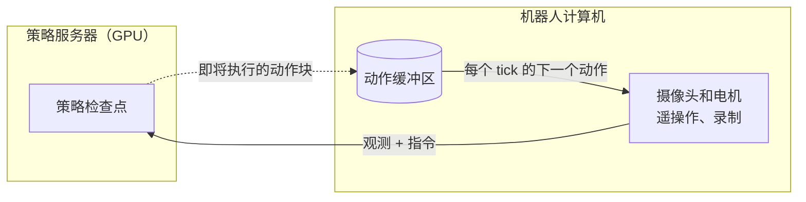
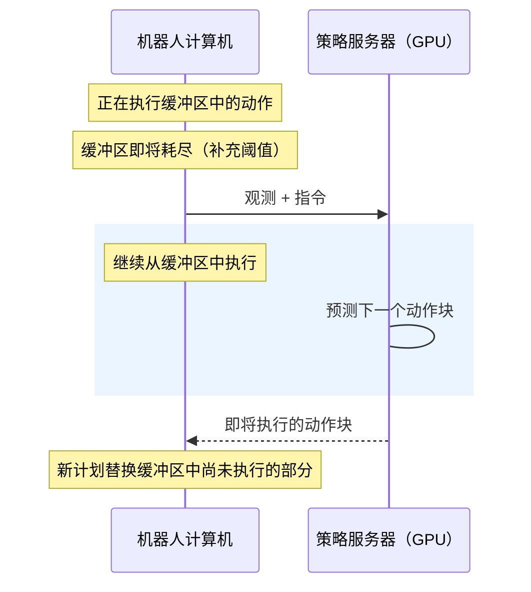

# 远程推理[[remote-inference]]

大型策略需要 GPU，而在同步 rollout 中，每当策略计算下一段动作块时，机器人都会停止运动。远程推理将工作拆分为两部分：**策略服务器**在 GPU 上运行检查点，**机器人计算机**继续控制摄像头、电机、遥操作和录制。服务器计算下一批动作时，机器人继续执行已经拥有的动作，因此运动不再因推理而暂停。

在以下情况下使用它：

- 连接机器人的计算机没有 GPU，或 GPU 对策略来说太小：机械臂旁边是笔记本电脑或单板计算机，实验室另一侧是 GPU 工作站；
- 推理占用每个动作块的显著比例，而你想要连续运动；
- 你想在不改动检查点的情况下决定机器人多久重新规划一次。

你要调节的唯一权衡是**新鲜度与连续性**。更早请求新计划可以让机器人对它看到的内容作出反应；执行当前计划的更多部分可以保持任务进展。

## 工作原理[[how-it-works]]



机器人计算机保留一个即将执行动作的缓冲区。当缓冲区即将耗尽时，它会发送新的观测，在服务器计算期间继续从缓冲区运动，并将新动作块拼接到计划中尚未执行的部分。



三个客户端设置会影响这种行为。`refill_seconds` 决定提前多久请求下一个计划，`chunk_merge` 决定新计划如何拼接到旧计划中，而混合会平滑两者之间的接缝。服务器只需要检查点和它所训练机器人的描述。以下各节从可工作的设置开始，然后逐步建立对每个设置的直观理解。

**本地 RTC**（`--inference.type=rtc`）是另一种异步选项：推理在 rollout 进程的后台线程中运行，位于同一台机器上，无需服务器。同一主机上的远程推理仍然使用两个进程和 `--inference.type=remote`，并为没有 RTC 的策略提供对齐和混合。参见 [RTC 与远程推理的关系](./rtc#how-rtc-relates-to-remote-inference)。

### 支持的策略和机器人[[supported-policies-and-robots]]

当检查点保存的处理器能够从单个当前观测预测动作块时，该检查点就可以被服务；ACT 需要禁用时间集成。ACT、SmolVLA、XVLA、EVO1 和 LaWAM 检查点已经通过此路径在真实机器人上运行。其他几种策略在契约层面受到支持，但尚未在硬件上验证，而依赖历史的策略需要额外集成。[策略支持表](https://github.com/huggingface/lerobot/blob/main/src/lerobot/remote_inference/README.md#policy-support)列出了每个策略的状态和限制。

机器人驱动器必须声明位置保持支持，因为客户端在等待动作时会刷新最后应用的目标。SO、OMX、Koch、HopeJr 和 Rebot 从臂声明了该支持；OpenArm、Reachy2 和双臂包装器取决于其配置；Unitree G1 仅在 SONIC 控制器下声明该支持，其保留目标是最后一个运动 token；移动底座则不支持。参见[硬件表](./integrate_hardware#waiting-between-predictions)。不支持的机器人或策略契约会在准入时被拒绝，且不会发生任何运动。

## 从可工作的 rollout 开始[[start-from-a-working-rollout]]

保留一条成功的同步 `lerobot-rollout` 命令作为参考，并保留其机器人、摄像头、任务、FPS、遥操作器和插值设置。检查点和模型设备移到服务器；远程客户端不加载权重。

下面的示例描述了一个**通用六执行器 SO-101，带一个前视摄像头**。请一起调整检查点、摄像头视图、组件顺序和单位。

### 1. 在两台计算机上安装[[1-install-on-both-computers]]

双方都需要 `remote` extra。将硬件 extra 保留在客户端，并将所选策略的 extra 保留在服务器：

```bash
uv sync --locked --extra remote --extra core_scripts --extra feetech
# 需要时在服务器上添加策略 extra，例如 --extra pi。
```

支持的 Zenoh 范围是 `>=1.9.0,<1.11.0`；`uv sync --locked` 会安装锁定文件中的版本，目前是 1.10.1。

### 2. 配置并启动服务器[[2-configure-and-start-the-server]]

复制[通用配置](https://github.com/huggingface/lerobot/blob/main/examples/remote_inference/server.yaml)，然后编辑它：

```bash
cp examples/remote_inference/server.yaml server.yaml
```

设置 `model.repo_or_path` 和 `model.device`。对于 Hub 检查点，将 `model.revision` 固定为你打算验证的提交。将 `features`、`action_feature`、`semantics`、`robot_type` 和 `execution.action_fps` 与你可工作的设置匹配；参见下文 [schema 和摄像头重命名示例](#configuration-and-networking)。

```bash
uv run --no-sync lerobot-policy-server --config_path=server.yaml
```

服务器会加载检查点、验证其声明、运行预热，然后记录 `Policy server ready: deployment=<name> instance=<id>; awaiting one client`。每个 YAML 字段都接受嵌套 CLI 覆盖：

```bash
uv run --no-sync lerobot-policy-server --config_path=server.yaml \
  --model.device=cuda \
  --execution.idle_timeout_s=10
```

### 3. 启动机器人客户端[[3-start-the-robot-client]]

在另一个终端中，将硬件参数调整为相同的配置：

```bash
uv run --no-sync lerobot-rollout \
  --inference.type=remote \
  --inference.endpoint=tcp/127.0.0.1:7447 \
  --inference.deployment=manipulation \
  --inference.mode=chunk \
  --inference.chunk_merge=aligned \
  --inference.semantics=so101-degrees-gripper-percent-v1 \
  --robot.type=so101_follower \
  --robot.port=/dev/ttyACM0 \
  --robot.use_degrees=true \
  --robot.cameras='{front: {type: opencv, index_or_path: 0, width: 640, height: 480, fps: 30}}' \
  --fps=30 \
  --task="pick up the cube" \
  --interactive=true
```

准入后，输入 `/start`。`/stop` 结束运行；参见[机器人在等待或停止时会做什么](#what-the-robot-does-while-waiting-or-stopping)。保留你当前可工作 rollout 中的遥操作和录制选项。不要向远程客户端传递 `--policy.path`、本地模型设备覆盖或编译标志。

`deployment` 选择服务器，`semantics` 命名经过验证的动作单位和顺序；两者都必须与服务器配置匹配。示例使用身体关节角度和校准的 0–100 夹爪范围。

<details>
<summary>使用可信局域网而不是 localhost</summary>

将服务器绑定到其局域网接口，将示例地址替换为它的实际 IP：

```bash
uv run --no-sync lerobot-policy-server --config_path=server.yaml \
  --zenoh.listen_endpoints='[tcp/172.18.133.214:7447]'
```

在客户端上，使用相同地址：`--inference.endpoint=tcp/172.18.133.214:7447`。两台主机都必须能够访问该端点。

绑定特定接口可以限制暴露面，但不会验证对等方身份。在可信实验室网络之外，请使用[经过身份验证的路由器连接](#configuration-and-networking)。

</details>

## 选择如何继续运动[[choose-how-to-continue-the-motion]]

当新的动作块到达时，计算它所依据的观测已经有些旧了，而机器人已经继续运动。合并模式决定如何处理这一点：在旧动作块之后播放新动作块，丢弃机器人已经越过的步骤，或平滑衔接。

| 选择        | 客户端设置                                           | 有用的起点                                                                 |
| ----------- | ---------------------------------------------------- | -------------------------------------------------------------------------- |
| 追加        | `mode=chunk`，`chunk_merge=append`                   | 保留完整已接受的执行切片；可作为基线，但下一个动作块可能从较旧的观测开始。 |
| 对齐        | `mode=chunk`，`chunk_merge=aligned`（`auto` 默认值） | 移除已经越过的传入步骤，只替换未来部分，减少独立动作块之间的向后跳动。     |
| 对齐 + 混合 | 对齐加 `blend_steps > 0` 和显式组件                  | 在节奏和任务进度工作正常后，平滑重叠的新旧目标。                           |
| RTC         | `mode=rtc_guided` 或 `rtc_trained`                   | 当检查点支持 RTC 时使用：推理本身以剩余轨迹为条件。                        |

此表中的设置使用 `--inference.` 前缀。普通动作块默认使用对齐并禁用混合。已经在插值的目标已提交，无法替换。

对齐会丢弃已经提交的传入步骤。混合会对重叠的未来目标取平均。插值会在端点之间添加中间电机命令。RTC 会改变预测的生成方式。它们都不能保证运动平滑或抓取成功。

<details>
<summary>在示例中添加短混合</summary>

混合完全在客户端配置；服务器不需要混合设置或重启。从部署的动作名称中选择连续机械臂坐标：

```bash
--inference.chunk_merge=aligned \
--inference.blend_steps=5 \
--inference.blend_weight=0.5 \
--inference.blend_components='[shoulder_pan.pos, shoulder_lift.pos, elbow_flex.pos, wrist_flex.pos, wrist_roll.pos]'
```

这些是比较用设置，不是调优后的推荐值。除非经过验证，否则排除夹爪和其他离散或对接触敏感的控件。未选中的组件使用传入目标。

混合计算 `q_t + b_w * (i_t - q_t)`：`q_t` 是排队目标，`i_t` 是同一未来槽位的传入目标，`b_w` 是传入比例（`blend_weight`）。权重 1 表示替换。实际重叠会限制混合窗口；配置十个步骤并不能创造十个重叠步骤。重复替换可能会对未提交目标混合多次，保留较旧的影响及其原始年龄。混合永远不会刷新过期数据。

</details>

<details>
<summary>在兼容的检查点上服务引导式 RTC</summary>

保持经过验证的 schema，并配置服务器：

```bash
uv run --no-sync lerobot-policy-server --config_path=server.yaml \
  --execution.supported_modes='[rtc_guided]' \
  --execution.rtc.enabled=true \
  --execution.rtc.mode=guided \
  --execution.rtc.execution_horizon=15
```

在客户端设置 `--inference.mode=rtc_guided`。RTC 使用自己的延续处理，而不是普通动作块的对齐或混合。重新测量周转时间，因为引导会增加工作。15 步时域只是一个示例，不是调优值。

训练式 RTC 需要一个针对动作前缀条件训练并具有兼容延迟/时域设置的检查点；参见 [RTC 配置](./rtc)。请求不支持的模式会在运动前失败。

</details>

## 重要参数[[parameters-that-matter]]

除非另有说明，下面的客户端选项都使用 `--inference.` 前缀。默认值是起始值，并不是对特定机器人的保证。

| 参数                         | 默认值 / 单位              | 效果与权衡                                                               |
| ---------------------------- | -------------------------- | ------------------------------------------------------------------------ |
| `refill_seconds`             | `0.5` 秒的剩余播放时间     | 较高值通常会提前请求；较低值允许执行更多计划。实测延迟下限可能会覆盖它。 |
| `blend_steps`                | `0` 策略步数               | 零会禁用混合。更大的窗口会混合更多重叠的未来目标。                       |
| `blend_weight`               | `0.5` 传入比例             | 较低值会保留更多旧目标：可能变化更平缓，但纠正更慢。                     |
| `blend_components`           | `[]`                       | 服务器允许坐标的显式子集；启用混合时必填。                               |
| `max_observation_age_s`      | `5.0` 秒                   | 执行过程中原始来源的最大年龄，包括较旧的混合贡献者。必须覆盖推理和播放。 |
| `action_starvation_grace_s`  | `1.0` 秒                   | 播放耗尽后的有界等待；`0` 会立即报故障。不会覆盖其他截止时间。           |
| `--fps`                      | 与服务器 `action_fps` 匹配 | 策略动作频率。对于 `N` 个动作，名义播放时间为 `N / fps` 秒。             |
| `--interpolation_multiplier` | `1`                        | 更多中间电机命令；不会延长播放时间，也不会增加策略决策。                 |

有效补充为 `max(refill_seconds, recent maximum turnaround + 1 / fps)`。周转时间包括编码、网络、排队、推理和解码。第一个被接受的请求提供初始估计；之后的估计最多使用 100 个稳态样本。

因此，补充既不是固定的请求周期，也不是已执行动作数量的保证。在日志中检查配置的**和有效的**补充。覆盖整个执行时域的阈值会导致非常频繁的替换。

<details>
<summary>运行截止时间与服务器所有权</summary>

所有值均以秒为单位。

| 客户端参数            | 默认值 | 界限                          |
| --------------------- | ------ | ----------------------------- |
| `handshake_timeout_s` | `10`   | 发现/准入；控制交换的基础预算 |
| `startup_timeout_s`   | `10`   | 确认重置/失效后的新动作启动   |
| `action_timeout_s`    | `5`    | 一个未完成动作请求            |
| `language_timeout_s`  | `60`   | 一个文本请求                  |

服务器还有 `execution.action_deadline_s=5` 和 `language.deadline_s=60`。客户端和服务器限制都适用；更改其中一个不会放宽另一个。重置/失效控制交换还会允许通告的服务器工作预算，因为它们必须等待正在运行的模型调用完成。

服务器 `execution.idle_timeout_s=10` 控制**观察到客户端缺席**后的清理，而不是动作饥饿宽限。清理会等待正在运行的模型工作；挂起的调用无法被接管。已连接但暂停的客户端会保留其会话。

</details>

## 机器人在等待或停止时会做什么[[what-the-robot-does-while-waiting-or-stopping]]

在受支持的等待期间，客户端会刷新**驱动器实际应用的最后一个目标**，包括插值、限幅和夹爪。在第一条命令之前，会用测量位姿初始化它。这会停止轨迹推进；机器人仍可能向该目标稳定。它不会关闭力矩，也不保证静止不动。本地 RTC 在受支持的机器人上使用相同的有界等待，在其他情况下耗尽时会立即报故障。

| 情况                                             | 预期行为                                                                   |
| ------------------------------------------------ | -------------------------------------------------------------------------- |
| 初始推理                                         | 在启动截止时间内，本地等待直到可用动作到达。                               |
| 动作耗尽                                         | 完成已提交的插值，然后最多在饥饿宽限期内保留目标。仅从新的观测和预测恢复。 |
| `/vqa` 或自动转向查询                            | 在文本生成前暂停；如果运行仍处于活动状态，之后从新动作恢复。语言界限适用。 |
| 推理期间指令变更                                 | 丢弃旧预测，暂停并为新指令获取新动作。请求之间的变更可以保留已接受的运动。 |
| 录制保存或操作员暂停                             | 保留目标，或将控制权交给遥操作。阻塞的录制工作会在适当时以新的推理恢复。   |
| 截止时间、过期动作、格式错误回复或饥饿宽限期耗尽 | 终止故障：撤销策略运动并遵循配置的关闭流程。                               |
| `/stop` 或正常 Ctrl+C                            | 结束策略运动并遵循配置的返回/断开行为。                                    |

饥饿恢复会排空旧的进行中预测，并从等待开始后进行的采集获取新预测。旧结果无法重新启动运动。数据包和不可用结果不会续期宽限期。频繁等待表明播放或延迟覆盖不足。

**服务器或连接丢失不会自动恢复。** 有效的缓冲动作可能会被排空，随后等待直到宽限期或其他截止时间到期。一旦观察到服务器不存在，该会话在连接恢复后也无法继续；请为新会话重启 rollout。在文本工作期间，观察到服务器丢失会使查询故障。

在观测采集和执行器控制正常的情况下，终止关闭会遵循 `--return_to_initial_position=true`（默认值），然后断开连接。返回会读取完整观测，因此持续摄像头故障可能会阻止返回。动作或保持应用失败会抑制进一步运动。将该选项设为 `false` 会跳过返回，而不是断开连接。断开连接可能会根据机器人配置释放力矩。终止故障会在清理后以非零状态退出；被强制终止的进程无法保证清理。

## 调优一个可工作的任务[[tune-one-working-task]]

从接近同步参考开始：执行每次预测的很大一部分，但请求要足够早以隐藏推理延迟。然后评估更频繁的重新规划是否有帮助。

1. **首先使用对齐而不使用混合。** 保持 FPS、插值和设置不变。检查执行时域、完整周转时间和慢请求。
2. **留出余地选择补充覆盖。** 为另一个请求和延迟变化留出足够的播放时间，同时不要持续替换计划。
3. **在该节奏下添加短混合。** 分别比较任务完成情况、抓取/释放和跳动。对不兼容计划进行平滑平均可能会错过物体。
4. **仅为获得收益才提前请求。** 增加补充可以提高响应性，但会中断有用的进展。如果任务性能变差，回到稳定节奏。
5. **一次只更改一个设置。** 增加超时或宽限并不能提供缺失的动作。减少补充不是解决耗尽的通用方法。

对于 `0.8 s` 执行时域和稳定成功的对齐，请求间隔约为 `0.8 - effective_refill`：

| 有效补充 | 近似间隔 | 需要观察的内容                   |
| -------- | -------- | -------------------------------- |
| `0.2 s`  | `0.6 s`  | 更多后续执行，对慢请求的保护更少 |
| `0.4 s`  | `0.4 s`  | 更早替换，更多纠正机会           |
| `0.6 s`  | `0.2 s`  | 频繁变更；检查任务进度           |

这排除了启动、保持、饱和和控制 tick 效应。一个请求在剩余 `0.2 s` 时开始并耗时 `0.1 s`，就只剩下 `0.1 s` 用于混合，即 30 Hz 下的三步。因此，接近同步的节奏可能只需要短混合。

对于对齐和 RTC，检查**裁剪后的可用播放时间**，而不是名义动作块长度。如果推理在 1.67 秒的预测中占用 1 秒，就只剩下约 0.67 秒。另一个 1 秒请求无法容纳；没有任何补充值能解决这一点。减少周转时间、使用更长的受支持时域，或验证不同的动作频率。

来源年龄包括执行。对于追加，允许大约 `execution horizon + effective refill` 加上采集/推理余量。一个 30 Hz 的 100 步动作块已经跨越 3.33 秒。对齐通常会降低年龄，但重复混合可能会保留较旧的贡献者。

## 读取日志并诊断一次运行[[read-the-logs-and-diagnose-a-run]]

INFO 日志显示准入和有效设置、文本请求结果、等待/关闭转换，以及大约每五秒一次的活动摘要。将周转时间和排队播放时间一起阅读。有关详细信息，请使用服务器 `--log_level=DEBUG` 和客户端 `--inference.log_level=DEBUG`。交互式会话会将客户端低于 ERROR 的日志静音；收集实时计时日志时请使用非交互式运行。

保存日志时，使用 `2>&1 | tee -i server.log`（或 `client.log`）。当 Ctrl+C 到达整个管道时，`-i` 会让 `tee` 保持存活，因此它也会捕获优雅关闭消息。

| 观察                     | 下一个有用的检查                                                              |
| ------------------------ | ----------------------------------------------------------------------------- |
| 追加导致向后跳动         | 在相同设置下比较对齐；下一个完整动作块可能从较旧的观测开始。                  |
| 对齐平滑但任务成功率下降 | 在延迟余量内降低补充以减少替换频率。先调整节奏再混合。                        |
| 混合看起来犹豫不决       | 缩短其窗口或增加传入权重；在工作节奏下比较不使用混合的情况。                  |
| 反复等待 / 动作耗尽      | 检查慢周转时间、丢失/停滞的请求以及裁剪后的播放时间。仅在时域允许时增加余量。 |
| 补充变更没有效果         | 实测延迟下限可能占主导；检查有效补充。                                        |
| 陈旧来源故障             | 检查最旧来源年龄、时域和混合。新回复不会刷新旧贡献者。                        |
| 客户端重启后出现 `BUSY`  | 等待缺席客户端清理和正在运行的工作。被拒绝的重连不会续期所有权宽限期。        |
| 契约不匹配               | 比较 schema、模式和启动软件元数据；重启或更新不兼容的进程。                   |

DEBUG 包括每个请求在提交时的播放时间、观测年龄和游标进度，以及每个结果的裁剪后/可用步数和重叠。这些描述的是指令进度，而不是实测物理执行。

## 配置与网络[[configuration-and-networking]]

为检查点、机器人 schema 和服务器设置保留一个部署 YAML；实验使用嵌套 CLI 覆盖。为独立实验提供不同的部署名称。两个进程都会记录其软件包和协议版本；准入会检查协议以及执行/数据契约，但不要求软件包版本完全相同。

<details>
<summary>Schema、摄像头名称和检查点要求</summary>

维护的 [server.yaml](https://github.com/huggingface/lerobot/blob/main/examples/remote_inference/server.yaml) 包含所有必填字段。`features` 和 `action_feature` 声明形状、dtype 和语义；状态/动作向量还声明组件顺序。图像使用 RGB `uint8`，高度 × 宽度 × 3。例如：

```yaml
features:
  - name: observation.state
    shape: [6]
    dtype: float32
    names:
      [
        shoulder_pan.pos,
        shoulder_lift.pos,
        elbow_flex.pos,
        wrist_flex.pos,
        wrist_roll.pos,
        gripper.pos,
      ]
    semantics: so101-degrees-gripper-percent-v1
  - name: observation.images.front
    shape: [480, 640, 3]
    dtype: uint8
    kind: rgb
    semantics: rgb-front-table-v1
```

使用面向检查点的名称。要将名为 `scene` 的机器人摄像头映射到检查点的 `front` 视图，请设置客户端 `--rename_map='{"observation.images.scene":"observation.images.front"}'`。重命名不能改变视图、分辨率或标定。额外摄像头可以保留用于录制，而无需发送到服务器。

受支持的策略使用保存的处理器，并从当前观测直接预测动作块。依赖历史的策略、潜在控制器输出以及仅通过 `select_action()` 可用的准备需要额外集成。仅成功的同步推理或预热并不能证明远程任务质量或语言/RTC 支持。

对于受支持的仅动作块检查点，服务器 `--execution.n_action_steps=30` 可以缩短其执行切片而无需编辑检查点。它不能超过预测时域，并且对于 RTC 部署会被拒绝。可选的客户端 `--inference.expected_artifact=...` 会固定模型/处理器内容和有效推理设置；仅部署名称不是检查点身份。

</details>

<details>
<summary>独立部署、带宽和连接丢失</summary>

将服务器 `--deployment=arm-a` 与客户端 `--inference.deployment=arm-a` 配对。名称必须是单个由字母数字/下划线/点/连字符组成的段。每个服务器进程仍然只服务一个活动客户端。如果多个实例通告相同名称，请选择 `--inference.instance=...` 或使用不同名称；发现不会任意选择。

流量范围位于 `lerobot/inference/v1/deployments/{deployment}` 之下，然后按服务器实例和会话划分。查询/回复处理发现、准入和控制；发布/订阅承载推理数据；活性跟踪存在。显式端点会禁用多播/gossip 发现。序列/生成标识和客户端本地计时控制运动；不需要同步主机时钟。

原始 RGB 是无损的，也是默认值。尝试 `--inference.encoding=jpeg --inference.jpeg_quality=90` 以减少图像带宽，然后比较周转时间和任务质量。质量范围为 1 到 100；任意张量绝不会进行 JPEG 编码。

活性可能只有在传输租约到期后才会检测到连接断开。通过客户端 `--inference.zenoh_config_path` 或服务器 `--zenoh.config_file` 提供的 Zenoh JSON5 文件可以调整 `transport/link/tx/lease`。这不会改变动作截止时间、饥饿宽限或缺席客户端所有权清理。观测拥塞会丢弃数据，而不是阻塞电机派发。

服务器 `presence restored` 会取消所有权清理；它不能复活已经故障的客户端。策略重置失败会使部署不可用，即使其进程仍然存活；请解决故障并重启它。

</details>

<details>
<summary>通过经过身份验证的路由器进行私有连接</summary>

路由器为机器人和 GPU 进程提供一个可到达的汇合点，包括多个独立实验。它会增加延迟和一个故障点；它不提供自动防火墙穿透、模型调度或运动恢复。裸 TCP 和会话 ID 不会验证对等方身份。

使用维护的 [Zenoh 配置](https://github.com/huggingface/lerobot/tree/main/examples/remote_inference/zenoh)：`router.json5`、`server.json5` 和 `robot.json5`。它们使用 TLS、双向证书验证、禁用发现和基于角色的 ACL。在配置的路径下配置私有 CA 以及单独的 router/server/robot 证书。每个进程只需要自己的私钥和 CA 证书；将 CA 密钥保存在其他地方。对于局域网部署，一致地将 `localhost` 替换为路由器的主机名，并签发覆盖该名称的证书。

```bash
zenohd --config examples/remote_inference/zenoh/router.json5

uv run --no-sync lerobot-policy-server --config_path=server.yaml \
  --zenoh.mode=client \
  --zenoh.listen_endpoints='[]' \
  --zenoh.connect_endpoints='[tls/localhost:7447]' \
  --zenoh.config_file=examples/remote_inference/zenoh/server.json5
```

添加到常规 rollout 命令：

```bash
--inference.endpoint=tls/localhost:7447 \
--inference.zenoh_mode=client \
--inference.zenoh_config_path=examples/remote_inference/zenoh/robot.json5
```

更改 ACL 部署路径时，也要一起更改部署名称。所有参与者都使用客户端模式，没有直接对等链路。该示例分离了机器人和服务器角色，但共享角色证书会共享权限；为不同信任组使用单独的授权身份。路由器 ACL 无法防御被攻陷的机器人进程，也无法管控其内部本地流量。参见 Zenoh 的 [TLS](https://zenoh.io/docs/manual/tls/) 和 [ACL](https://zenoh.io/docs/manual/access-control/) 文档。

`zenohd` 二进制文件和 Python 绑定必须是兼容版本。要检查已安装的路由器与已安装的绑定是否兼容，包括 TLS 和 ACL 强制执行：

```bash
LEROBOT_ZENOHD=/absolute/path/to/zenohd \
  uv run --no-sync pytest tests/remote_inference/test_zenoh.py -q -rs
```

这些检查还需要 `openssl`；不可用的先决条件会报告为跳过。通过路由器、私有托管的 GPU 或 Hugging Face Space 操作机器人尚未经过验证。在通过新拓扑操作机器人之前，测量完整周转时间和中断行为；仅传输可用并不能建立可用的运动预算。

</details>

## 语言与录制[[language-and-recording]]

通过 [交互式 rollout](./inference#interactive-sessions) 使用 `/vqa`、`/subtask` 和 `/autosteer`。仅在实现文本生成的检查点上启用服务器 `language.enabled=true`；自动转向还需要一个针对子任务生成训练并具有兼容目标/子任务提示的检查点。当检查点声明该能力时，服务器会暴露这些命令；答案和子任务是否有用取决于检查点。

文本工作会暂停运动并丢弃缓冲的后续动作。VQA 会保留你的指令，并以新预测恢复，因此机器人在重新规划时可能会丢失任务进度，即使答案成功也是如此。在信息性 VQA 查询期间保持缓冲运动继续运行已列入计划；参见[未来工作](https://github.com/huggingface/lerobot/blob/main/src/lerobot/remote_inference/README.md#13-future-work)。

录制使用常规本地数据集格式。任务标签跟随派发的动作。诊断信息保留在应用日志中；它们不会写入数据集或上传。使用数据集时，为初始指令使用 `--dataset.single_task`；否则使用 `--task`。优先使用其中一种，以避免配置冲突。

## 从 Python 使用[[use-it-from-python]]

共享引擎和配置位于 `lerobot.inference`；远程客户端、引擎和服务器位于 `lerobot.remote_inference`。在 `lerobot-rollout` 之外的控制循环会连接并准入客户端，将其包装到引擎中，发布采集，并通过 `dispatch_tick` 派发每个电机 tick；后者应用与 CLI 相同的许可、保持和确认契约：

```python
import time

import numpy as np

from lerobot.inference import RemoteInferenceConfig, dispatch_tick
from lerobot.remote_inference import RemoteClient, RemoteInferenceEngine
from lerobot.utils.action_interpolator import ActionInterpolator

config = RemoteInferenceConfig(
    endpoint="tcp/127.0.0.1:7447",
    deployment="manipulation",
    semantics="so101-degrees-gripper-percent-v1",
)
client = RemoteClient.connect(config)
caps = client.capabilities
client.admit(
    features=caps.features,
    action_feature=caps.action_feature,
    semantics=config.semantics,
    action_interval=caps.action_interval,
    mode=config.mode,
)
engine = RemoteInferenceEngine(client, config, task="pick up the cube")
interpolator = ActionInterpolator(multiplier=1)

engine.start()
engine.resume()
try:
    while running():
        captured = time.monotonic()
        engine.submit_observation(
            {"observation.state": state_vector(), "observation.images.front": front_rgb()},
            capture_time=captured,
        )
        # send() 接收按部署动作顺序排列的 torch 张量；hold() 刷新
        # 最后应用的目标。当 tick 被保持或饥饿时返回 None。
        dispatch_tick(engine, interpolator, send=robot_send, hold=robot_hold)
finally:
    engine.stop()  # 撤销运动并关闭客户端
```

观测以面向检查点的特征名称为键，并且必须匹配服务器 schema：按声明组件顺序排列的 `float32` 向量，以及声明大小的 RGB `uint8` 图像。[`tests/remote_inference/test_library_client.py`](https://github.com/huggingface/lerobot/blob/main/tests/remote_inference/test_library_client.py) 在环回服务器上运行此路径，是调用序列的参考。`lerobot-rollout` 在其之上添加驱动器转换、位置保持检查、交互式命令和录制；`lerobot-policy-server` 是服务入口点，仅通过其 YAML 和 CLI 覆盖进行配置。

<details>
<summary>从 lerobot[async] 迁移</summary>

已停用的 `lerobot[async]` extra 和 `lerobot.async_inference` 命令已由 `lerobot[remote]`、`lerobot-policy-server` 和 `lerobot-rollout --inference.type=remote` 替换。旧的动作块大小阈值和聚合权重不能与补充、对齐和混合互换；请根据上文的[参数](#parameters-that-matter)重新调参。

旧的 `lerobot.rollout.inference` 导入位置已移除，改用 `lerobot.inference` 和 `lerobot.remote_inference`。没有 `hold_mode` 选项：远程执行要求驱动器声明位置保持，rollout 会自动检查。

对于搭载 SONIC 的 Unitree G1，请遵循 [G1 远程操作指南](./unitree_g1#run-on-the-physical-robot)，而不是改编旧命令；G1 运动控制器仍不受支持。

</details>

有关架构、执行契约和计划扩展，请参见[工程设计参考](https://github.com/huggingface/lerobot/blob/main/src/lerobot/remote_inference/README.md)。
