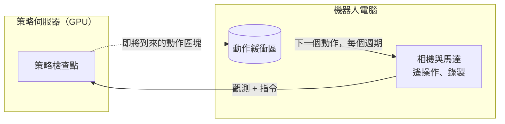
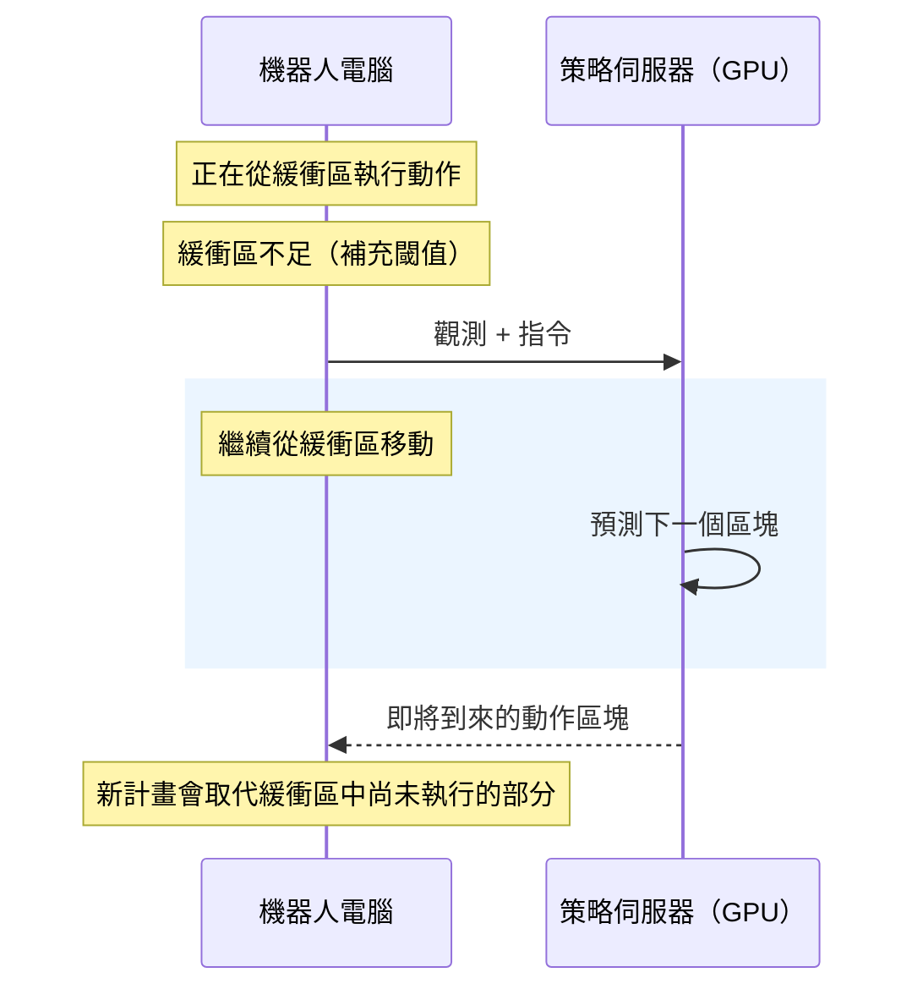

# 遠端推論[[remote-inference]]

大型策略（policy）需要 GPU，而在同步 rollout 中，每當策略計算下一段動作區塊（action chunk）時，機器人都會停止移動。遠端推論（remote inference）會將工作拆成兩部分：**策略伺服器**（policy server）在 GPU 上執行檢查點（checkpoint），而**機器人電腦**（robot computer）則持續控制相機、馬達、遙操作（teleoperation）與錄製。伺服器計算下一批動作時，機器人會繼續執行已持有的動作，因此移動不再因推論（inference）而暫停。

使用時機：

- 連接到機器人的電腦沒有 GPU，或 GPU 太小而無法執行策略：例如手臂旁的一台筆記型電腦或單板電腦，以及實驗室另一端的 GPU 工作站；
- 推論佔每個動作區塊相當明顯的比例，而你希望動作連續；
- 你想要決定機器人重新規劃的頻率，而不必修改檢查點。

你要調整的唯一取捨是**新鮮度與連續性**。越早要求新計畫，機器人就越能對所見做出反應；跟隨更多目前計畫則可保留任務進度。

## 運作方式[[how-it-works]]



機器人電腦會保留即將執行的動作緩衝區。當緩衝區不足時，它會傳送新的觀測（observation），並在伺服器計算時繼續從緩衝區移動，然後將新區塊拼接進尚未執行的計畫部分。



三個用戶端設定會影響此行為。`refill_seconds` 決定提早多久要求下一個計畫，`chunk_merge` 決定新計畫如何拼接進舊計畫，而混合則會撫平兩者之間的接縫。伺服器只需要檢查點，以及它所訓練的機器人描述。以下各節會從可運作的設定開始，然後為每個設定建立直覺。

**本機 RTC**（`--inference.type=rtc`）是另一個非同步選項：推論會在 rollout 行程的背景執行緒（thread）中於同一台機器上執行，不需要伺服器。在同一主機上的遠端推論仍使用兩個行程與 `--inference.type=remote`，並為沒有 RTC 的策略提供對齊與混合。請參閱 [RTC 與遠端推論的關係](./rtc#how-rtc-relates-to-remote-inference)。

### 支援的策略與機器人[[supported-policies-and-robots]]

當檢查點已儲存的處理器能從單一目前觀測預測動作區塊時，就可以提供該檢查點；ACT 需要停用時間集成。ACT、SmolVLA、XVLA、EVO1 與 LaWAM 檢查點已透過此路徑在真實機器人上執行。其他數個策略在契約層級受到支援，但尚未在硬體上驗證，而依賴歷史的策略需要額外整合。[策略支援表](https://github.com/huggingface/lerobot/blob/main/src/lerobot/remote_inference/README.md#policy-support) 列出每個策略的狀態與限制。

機器人驅動程式必須宣告支援位置保持，因為用戶端在等待動作時會更新最後套用的目標。SO、OMX、Koch、HopeJr 與 Rebot 從臂會宣告支援；OpenArm、Reachy2 與雙臂包裝器則取決於其設定；Unitree G1 只有在使用 SONIC 控制器時才會宣告支援，其保留的目標是最後一個動作 token；行動底座則不會。請參閱[硬體表](./integrate_hardware#waiting-between-predictions)。不支援的機器人或策略契約會在許可時、任何移動之前被拒絕。

## 從可運作的 rollout 開始[[start-from-a-working-rollout]]

保留一個成功的同步 `lerobot-rollout` 指令作為參考，並保留其機器人、相機、任務、FPS、遙操作器與插值設定。檢查點與模型裝置會移到伺服器；遠端用戶端不會載入權重。

以下範例描述**通用六致動器 SO-101 搭配一個前相機**。請一併調整檢查點、相機視角、元件順序與單位。

### 1. 在兩台電腦上安裝[[1-install-on-both-computers]]

兩邊都需要 `remote` 額外套件。將硬體額外套件保留在用戶端，並將所選策略的額外套件放在伺服器：

```bash
uv sync --locked --extra remote --extra core_scripts --extra feetech
# 需要時在伺服器加入策略額外套件，例如 --extra pi。
```

支援的 Zenoh 範圍是 `>=1.9.0,<1.11.0`；`uv sync --locked` 會安裝鎖定檔版本，目前是 1.10.1。

### 2. 設定並啟動伺服器[[2-configure-and-start-the-server]]

複製[通用設定](https://github.com/huggingface/lerobot/blob/main/examples/remote_inference/server.yaml)，然後編輯它：

```bash
cp examples/remote_inference/server.yaml server.yaml
```

設定 `model.repo_or_path` 與 `model.device`。對於 Hub 檢查點，將 `model.revision` 固定到你打算驗證的提交。讓 `features`、`action_feature`、`semantics`、`robot_type` 與 `execution.action_fps` 符合你可運作的設定；請參閱下方的[結構描述與相機重新命名範例](#configuration-and-networking)。

```bash
uv run --no-sync lerobot-policy-server --config_path=server.yaml
```

伺服器會載入檢查點、驗證其宣告、執行暖機，然後記錄 `Policy server ready: deployment=<name> instance=<id>; awaiting one client`。每個 YAML 欄位都接受巢狀 CLI 覆寫：

```bash
uv run --no-sync lerobot-policy-server --config_path=server.yaml \
  --model.device=cuda \
  --execution.idle_timeout_s=10
```

### 3. 啟動機器人用戶端[[3-start-the-robot-client]]

在另一個終端機中，將硬體引數調整為相同設定：

```bash
uv run --no-sync lerobot-rollout \
  --inference.type=remote \
  --inference.endpoint=tcp/127.0.0.1:7447 \
  --inference.deployment=manipulation \
  --inference.mode=chunk \
  --inference.chunk_merge=aligned \
  --inference.semantics=so101-degrees-gripper-percent-v1 \
  --robot.type=so101_follower \
  --robot.port=/dev/ttyACM0 \
  --robot.use_degrees=true \
  --robot.cameras='{front: {type: opencv, index_or_path: 0, width: 640, height: 480, fps: 30}}' \
  --fps=30 \
  --task="pick up the cube" \
  --interactive=true
```

許可後，輸入 `/start`。`/stop` 會結束該次執行；請參閱[機器人在等待或停止時的行為](#what-the-robot-does-while-waiting-or-stopping)。保留你可運作 rollout 中的遙操作與錄製選項。不要將 `--policy.path`、本機模型裝置覆寫或編譯旗標傳給遠端用戶端。

`deployment` 會選取伺服器，而 `semantics` 會命名已驗證的動作單位與順序；兩者都必須符合伺服器設定。範例使用身體關節度數與校準過的 0–100 夾爪範圍。

<details>
<summary>使用受信任的區域網路而非 localhost</summary>

將伺服器綁定到其區域網路介面，並將範例位址取代為其實際 IP：

```bash
uv run --no-sync lerobot-policy-server --config_path=server.yaml \
  --zenoh.listen_endpoints='[tcp/172.18.133.214:7447]'
```

在用戶端上，使用相同位址：`--inference.endpoint=tcp/172.18.133.214:7447`。兩台主機都必須能連線到該端點。

綁定特定介面可限制暴露，但不會驗證對等端。在受信任的實驗室網路之外，請使用[已驗證的路由器連線](#configuration-and-networking)。

</details>

## 選擇如何延續動作[[choose-how-to-continue-the-motion]]

當新區塊到達時，用來計算它的觀測已經有點舊，而且機器人已經繼續前進。合併模式會決定如何處理這種情況：在舊區塊之後播放新區塊、丟棄機器人已經過的步驟，或撫平接合處。

| 選擇        | 用戶端設定                                         | 有用的起點                                                                 |
| ----------- | -------------------------------------------------- | -------------------------------------------------------------------------- |
| 附加        | `mode=chunk`, `chunk_merge=append`                 | 保留完整已接受的執行切片；可作為基準，但下一個區塊可能會從較舊的觀測開始。 |
| 對齊        | `mode=chunk`, `chunk_merge=aligned`（`auto` 預設） | 移除已過的傳入步驟，只取代未來部分，減少獨立區塊之間的向後跳動。           |
| 對齊 + 混合 | 對齊加上 `blend_steps > 0` 與明確元件              | 在節奏與任務進度運作正常後，平滑重疊的新舊目標。                           |
| RTC         | `mode=rtc_guided` 或 `rtc_trained`                 | 當檢查點支援 RTC 時使用：推論本身會以剩餘軌跡為條件。                      |

此表中的設定使用 `--inference.` 前綴。一般區塊預設為對齊且停用混合。已在插值的目標會被提交，無法取代。

對齊會丟棄已提交的傳入步驟。混合會平均重疊的未來目標。插值會在端點之間加入中間馬達命令。RTC 會改變預測的產生方式。這些都無法保證動作平滑或成功抓取。

<details>
<summary>在範例中加入短暫混合</summary>

混合完全在用戶端設定；伺服器不需要混合設定或重新啟動。從部署的動作名稱中選取連續手臂座標：

```bash
--inference.chunk_merge=aligned \
--inference.blend_steps=5 \
--inference.blend_weight=0.5 \
--inference.blend_components='[shoulder_pan.pos, shoulder_lift.pos, elbow_flex.pos, wrist_flex.pos, wrist_roll.pos]'
```

這些是比較用設定，不是調校後的建議。除非已驗證，否則請排除夾爪與其他離散或對接觸敏感的控制項。未選取的元件會使用傳入目標。

混合會計算 `q_t + b_w * (i_t - q_t)`：`q_t` 是佇列中的目標，`i_t` 是同一未來時槽的傳入目標，而 `b_w` 是傳入比例（`blend_weight`）。權重 1 代表取代。實際重疊會限制混合視窗；十個設定的步驟無法產生十個重疊步驟。重複取代可能會對未提交目標混合超過一次，保留較舊的影響及其原始年齡。混合永遠不會更新過期資料。

</details>

<details>
<summary>在相容的檢查點上提供引導式 RTC</summary>

保留已驗證的結構描述並設定伺服器：

```bash
uv run --no-sync lerobot-policy-server --config_path=server.yaml \
  --execution.supported_modes='[rtc_guided]' \
  --execution.rtc.enabled=true \
  --execution.rtc.mode=guided \
  --execution.rtc.execution_horizon=15
```

在用戶端設定 `--inference.mode=rtc_guided`。RTC 使用自己的延續處理，而不是一般區塊的對齊或混合。重新量測往返時間，因為引導會增加工作。15 步時域是範例，不是調校後的值。

訓練式 RTC 需要一個已針對動作前綴條件化訓練的檢查點，以及相容的延遲／時域設定；請參閱 [RTC 設定](./rtc)。要求不支援的模式會在移動之前失敗。

</details>

## 重要參數[[parameters-that-matter]]

以下用戶端選項除非另有說明，否則使用 `--inference.` 前綴。預設值是起始值，不是對特定機器人的保證。

| 參數                         | 預設／單位              | 效果與取捨                                                                 |
| ---------------------------- | ----------------------- | -------------------------------------------------------------------------- |
| `refill_seconds`             | `0.5` 秒的剩餘播放      | 較高通常會較早請求；較低則允許更多計畫執行。量測到的延遲下限可以覆寫它。   |
| `blend_steps`                | `0` 策略步數            | 零會停用混合。較大的視窗會混合更多重疊的未來目標。                         |
| `blend_weight`               | `0.5` 傳入比例          | 較低會保留更多舊目標：可能更平緩，但修正較慢。                             |
| `blend_components`           | `[]`                    | 伺服器允許座標的明確子集；啟用混合時為必填。                               |
| `max_observation_age_s`      | `5.0` 秒                | 執行期間允許的原始來源最大年齡，包括較舊的混合貢獻者。必須涵蓋推論與播放。 |
| `action_starvation_grace_s`  | `1.0` 秒                | 播放耗盡後的有界等待；`0` 會立即故障。不會覆寫其他期限。                   |
| `--fps`                      | 符合伺服器 `action_fps` | 策略動作頻率。對於 `N` 個動作，名目播放為 `N / fps` 秒。                   |
| `--interpolation_multiplier` | `1`                     | 更多中間馬達命令；不會延長播放或增加策略決策。                             |

有效補充是 `max(refill_seconds, recent maximum turnaround + 1 / fps)`。往返時間包含編碼、網路、佇列、推論與解碼。第一個被接受的請求會提供初始估計；後續估計最多使用 100 個穩態樣本。

因此，補充既不是固定請求週期，也不是保證執行的動作數量。請在日誌中檢查已設定**與有效**的補充。涵蓋整個執行時域的閾值會導致非常頻繁的取代。

<details>
<summary>操作期限與伺服器擁有權</summary>

所有值皆以秒為單位。

| 用戶端參數            | 預設 | 界限                             |
| --------------------- | ---- | -------------------------------- |
| `handshake_timeout_s` | `10` | 探索／許可；控制交換的基礎預算   |
| `startup_timeout_s`   | `10` | 已確認重設／失效後的全新動作啟動 |
| `action_timeout_s`    | `5`  | 一個未完成的動作請求             |
| `language_timeout_s`  | `60` | 一個文字請求                     |

伺服器也有 `execution.action_deadline_s=5` 與 `language.deadline_s=60`。用戶端與伺服器限制都會生效；變更其中一個不會放寬另一個。重設／失效控制交換另外允許公告的伺服器工作預算，因為它們必須等待執行中的模型呼叫。

伺服器 `execution.idle_timeout_s=10` 控制**觀察到用戶端不存在**後的清理，而不是動作耗盡寬限。清理會等待執行中的模型工作；卡住的呼叫無法被接管。已連線但暫停的用戶端會保留其工作階段。

</details>

## 機器人在等待或停止時的行為[[what-the-robot-does-while-waiting-or-stopping]]

在支援的等待期間，用戶端會更新**驅動程式最後實際套用的目標**，包括插值、裁剪與夾爪。在第一個命令之前，量測到的姿態會初始化它。這會停止軌跡推進；機器人仍可能朝該目標穩定下來。它不會關閉扭矩，也不保證不動。本機 RTC 在支援的機器人上使用相同的有界等待，並在其他情況下於耗盡時立即故障。

| 情況                                           | 預期行為                                                                     |
| ---------------------------------------------- | ---------------------------------------------------------------------------- |
| 初始推論                                       | 在本機等待直到可用的動作到達，並在啟動期限內。                               |
| 動作用盡                                       | 完成已提交的插值，然後保留目標直到動作耗盡寬限。只能從新的觀測與預測繼續。   |
| `/vqa` 或自動轉向查詢                          | 在文字生成前暫停；若執行仍為作用中，之後從全新動作繼續。語言界限適用。       |
| 推論期間指令變更                               | 捨棄舊預測、暫停並為新指令取得全新動作。請求之間的變更可能保留已接受的動作。 |
| 錄製儲存或操作員暫停                           | 保留目標，或將控制交給遙操作。阻塞式錄製工作會在適當時以全新推論繼續。       |
| 期限、過期動作、格式錯誤回覆或動作耗盡寬限過期 | 終止性故障：撤銷策略動作並遵循設定的關機。                                   |
| `/stop` 或一般 Ctrl+C                          | 結束策略動作並遵循設定的返回／中斷連線行為。                                 |

動作耗盡復原會耗盡舊的進行中預測，並從等待開始後擷取的內容取得全新預測。舊結果無法重新啟動動作。封包與不可用結果不會更新寬限。頻繁等待表示播放或延遲涵蓋不足。

**伺服器或連線中斷不會自動復原。** 有效的緩衝動作可能會耗盡，接著等待直到寬限或其他期限到期。一旦觀察到伺服器不存在，即使連線恢復，該工作階段也無法繼續；請重新啟動 rollout 以建立新工作階段。文字工作期間，觀察到伺服器遺失會使查詢故障。

在觀測擷取與致動器控制正常時，終止性關機會遵循 `--return_to_initial_position=true`（預設），然後中斷連線。返回會讀取完整觀測，因此持續的相機故障可能使其無法進行。動作或保持套用失敗會抑制後續移動。將選項設為 `false` 會跳過返回，而不是中斷連線。中斷連線可能會依據機器人設定釋放扭矩。終止性失敗會在清理後以非零狀態退出；強制終止的行程無法保證清理。

## 調校一個可運作的任務[[tune-one-working-task]]

從接近同步參考開始：執行每次預測的相當大部分，但提早要求以隱藏推論延遲。然後評估更頻繁的重新規劃是否有幫助。

1. **先使用對齊但不混合。** 保持 FPS、插值與設定固定。檢查執行時域、完整往返時間與慢速請求。
2. **選擇有餘裕的補充涵蓋範圍。** 留下足夠播放時間給另一個請求與延遲變異，同時不要持續取代計畫。
3. **在該節奏加入短暫混合。** 分別比較任務完成度、抓取／釋放與跳動。不相容計畫的平滑平均可能會錯過物件。
4. **只有在有好處時才提早請求。** 增加補充可改善反應性，但會中斷有用的進展。若任務效能變差，返回穩定節奏。
5. **一次只變更一個設定。** 增加逾時或寬限不會提供缺少的動作。減少補充不是動作耗盡的萬靈丹。

對於 `0.8 s` 執行時域與穩定成功的對齊，請求間隔約為 `0.8 - effective_refill`：

| 有效補充 | 近似間隔 | 觀察重點                           |
| -------- | -------- | ---------------------------------- |
| `0.2 s`  | `0.6 s`  | 更多後續執行，對慢速請求的保護較少 |
| `0.4 s`  | `0.4 s`  | 較早取代，更多修正機會             |
| `0.6 s`  | `0.2 s`  | 頻繁變更；檢查任務進度             |

這排除啟動、保持、飽和與控制週期效應。一個在剩餘 `0.2 s` 時開始且耗時 `0.1 s` 的請求，只留下 `0.1 s` 可混合，也就是 30 Hz 下的三步。因此接近同步的節奏可能只需要短暫混合。

對於對齊與 RTC，檢查**裁剪後可用播放**，而不是名目區塊長度。若推論在 1.67 秒的預測中花費 1 秒，則只剩約 0.67 秒。另一個 1 秒請求無法放入；沒有任何補充值能解決。減少往返時間、使用更長的支援時域，或驗證不同的動作頻率。

來源資料的時效也包含執行時間。對於附加，允許大約 `execution horizon + effective refill` 再加上擷取／推論餘裕。在 30 Hz 下，100 步區塊已跨越 3.33 秒。對齊通常會降低時效，但重複混合可能保留較舊的貢獻者。

## 閱讀日誌並診斷執行[[read-the-logs-and-diagnose-a-run]]

INFO 日誌會顯示許可與有效設定、文字請求結果、等待／關機轉換，以及約每五秒一次的活動摘要。一起閱讀往返時間與佇列中的播放。如需詳細資訊，使用伺服器 `--log_level=DEBUG` 與用戶端 `--inference.log_level=DEBUG`。互動式工作階段會將 ERROR 以下的用戶端日誌靜音；收集即時計時日誌時，請使用非互動式執行。

儲存日誌時，使用 `2>&1 | tee -i server.log`（或 `client.log`）。當 Ctrl+C 傳到整個管線時，`-i` 可讓 `tee` 保持運作，因此也會擷取優雅關機訊息。

| 觀察                        | 下一個有用的檢查                                                             |
| --------------------------- | ---------------------------------------------------------------------------- |
| 附加造成向後跳動            | 在相同設定下比較對齊；下一個完整區塊可能會從較舊的觀測開始。                 |
| 對齊很順但任務成功率下降    | 在延遲餘裕內降低補充以減少取代頻率。先調整節奏，再混合。                     |
| 混合看起來猶豫不決          | 縮短其視窗或增加傳入權重；在可運作節奏下與不混合的情況比較。                 |
| 反覆等待／動作耗盡          | 檢查慢速往返時間、遺失／停滯的請求與裁剪後播放。只有在時域允許時才增加餘裕。 |
| 補充變更沒有作用            | 量測到的延遲下限可能主導；檢查有效補充。                                     |
| 來源過期故障                | 檢查最舊來源年齡、時域與混合。新回覆不會更新舊貢獻者。                       |
| 用戶端重新啟動後出現 `BUSY` | 等待用戶端不存在時的清理與執行中的工作。被拒絕的重新連線不會更新擁有權寬限。 |
| 契約不符                    | 比較結構描述、模式與啟動軟體中繼資料；重新啟動或更新不相容的行程。           |

DEBUG 包含每個請求提交時的播放、觀測年齡與游標進度，以及每個結果的裁剪後／可用步數與重疊。這些描述的是命令進度，而不是量測到的實體執行。

## 設定與網路[[configuration-and-networking]]

為檢查點、機器人結構描述與伺服器設定保留一份部署 YAML；實驗時使用巢狀 CLI 覆寫。為獨立實驗指定不同的部署名稱。兩個行程都會記錄其套件與協定版本；許可會檢查協定及執行／資料契約，但不要求套件版本完全相同。

<details>
<summary>結構描述、相機名稱與檢查點需求</summary>

維護中的 [server.yaml](https://github.com/huggingface/lerobot/blob/main/examples/remote_inference/server.yaml) 包含所有必填欄位。`features` 與 `action_feature` 會宣告形狀、dtype 與語意；狀態／動作向量也會宣告元件順序。影像使用 RGB `uint8`，高度 × 寬度 × 3。例如：

```yaml
features:
  - name: observation.state
    shape: [6]
    dtype: float32
    names:
      [
        shoulder_pan.pos,
        shoulder_lift.pos,
        elbow_flex.pos,
        wrist_flex.pos,
        wrist_roll.pos,
        gripper.pos,
      ]
    semantics: so101-degrees-gripper-percent-v1
  - name: observation.images.front
    shape: [480, 640, 3]
    dtype: uint8
    kind: rgb
    semantics: rgb-front-table-v1
```

使用面向檢查點的名稱。若要將名為 `scene` 的機器人相機對應到檢查點的 `front` 視角，設定用戶端 `--rename_map='{"observation.images.scene":"observation.images.front"}'`。重新命名無法變更視角、解析度或校準。其他相機可以保持可用於錄製，而不傳送到伺服器。

支援的策略會使用已儲存的處理器，並從目前觀測直接預測區塊。依賴歷史的策略、潛在控制器輸出，以及只能透過 `select_action()` 取得的準備內容，需要額外整合。僅有成功的同步推論或暖機，並不證明遠端任務品質或語言／RTC 支援。

對於支援的僅區塊檢查點，伺服器 `--execution.n_action_steps=30` 會縮短其執行切片，而不需編輯檢查點。它不能超過預測時域，且 RTC 部署會拒絕它。可選的用戶端 `--inference.expected_artifact=...` 會固定模型／處理器內容與有效推論設定；單獨的部署名稱不是檢查點身分。

</details>

<details>
<summary>獨立部署、頻寬與連線中斷</summary>

將伺服器 `--deployment=arm-a` 與用戶端 `--inference.deployment=arm-a` 配對。名稱必須是單一英數字／底線／點／連字號區段。每個伺服器行程仍然服務一個作用中的用戶端。若多個執行個體公告相同名稱，選擇 `--inference.instance=...` 或使用不同名稱；探索不會任意選擇。

流量範圍位於 `lerobot/inference/v1/deployments/{deployment}` 之下，然後依伺服器執行個體與工作階段區分。查詢／回覆處理探索、許可與控制；發布／訂閱承載推論資料；活躍性追蹤存在。明確端點會停用多播／gossip 探索。序列／生成識別與用戶端本機計時決定動作；不需要同步主機時鐘。

原始 RGB 無損且為預設。嘗試 `--inference.encoding=jpeg --inference.jpeg_quality=90` 以減少影像頻寬，然後比較往返時間與任務品質。品質範圍為 1 到 100；任意張量永遠不會經過 JPEG 編碼。

活躍性可能只有在傳輸租約到期後才會偵測到連線中斷。透過用戶端 `--inference.zenoh_config_path` 或伺服器 `--zenoh.config_file` 提供的 Zenoh JSON5 檔案可以調整 `transport/link/tx/lease`。這不會變更動作期限、動作耗盡寬限或用戶端不存在的擁有權清理。觀測壅塞會捨棄資料，而不會阻塞馬達分派。

伺服器 `presence restored` 會取消擁有權清理；它無法復活已故障的用戶端。策略重設失敗會使部署無法使用，即使其行程仍存活；解決失敗並重新啟動它。

</details>

<details>
<summary>透過已驗證路由器的私有連線</summary>

路由器為機器人與 GPU 行程提供可連線的會合點，包括多個獨立實驗。它會增加延遲與故障點；它不提供自動防火牆穿透、模型排程或動作復原。單純 TCP 與工作階段 ID 不會驗證對等端。

使用維護中的 [Zenoh 設定](https://github.com/huggingface/lerobot/tree/main/examples/remote_inference/zenoh)：`router.json5`、`server.json5` 與 `robot.json5`。它們使用 TLS、雙向憑證驗證、停用探索，以及角色型 ACL。在設定的路徑下佈建私有 CA 與各自的路由器／伺服器／機器人憑證。每個行程只需要自己的私密金鑰與 CA 憑證；將 CA 金鑰保存在其他地方。對於區域網路部署，將 `localhost` 一致地取代為路由器的主機名稱，並簽發涵蓋該名稱的憑證。

```bash
zenohd --config examples/remote_inference/zenoh/router.json5

uv run --no-sync lerobot-policy-server --config_path=server.yaml \
  --zenoh.mode=client \
  --zenoh.listen_endpoints='[]' \
  --zenoh.connect_endpoints='[tls/localhost:7447]' \
  --zenoh.config_file=examples/remote_inference/zenoh/server.json5
```

加入一般 rollout 指令：

```bash
--inference.endpoint=tls/localhost:7447 \
--inference.zenoh_mode=client \
--inference.zenoh_config_path=examples/remote_inference/zenoh/robot.json5
```

將 ACL 部署路徑與部署名稱一起變更。所有參與者都使用用戶端模式，且沒有直接對等連結。範例會區分機器人與伺服器角色，但共用角色憑證會共用權限；請為不同信任群組使用各自授權的身分。路由器 ACL 無法防禦已遭入侵的機器人行程，也無法管理其內部本機流量。請參閱 Zenoh 的 [TLS](https://zenoh.io/docs/manual/tls/) 與 [ACL](https://zenoh.io/docs/manual/access-control/) 文件。

`zenohd` 二進位檔與 Python 繫結必須是相容版本。若要檢查已安裝的路由器與已安裝繫結的相容性，包括 TLS 與 ACL 強制執行：

```bash
LEROBOT_ZENOHD=/absolute/path/to/zenohd \
  uv run --no-sync pytest tests/remote_inference/test_zenoh.py -q -rs
```

檢查也需要 `openssl`；無法取得的先決條件會回報為略過。透過路由器、私有託管 GPU 或 Hugging Face Space 操作機器人尚未經過驗證。透過新拓撲操作機器人之前，先量測完整往返時間與中斷行為；僅有可運作的傳輸並不足以建立可用的動作預算。

</details>

## 語言與錄製[[language-and-recording]]

透過[互動式 rollout](./inference#interactive-sessions) 使用 `/vqa`、`/subtask` 與 `/autosteer`。僅在實作文字生成的檢查點上啟用伺服器 `language.enabled=true`；自動轉向還需要一個已訓練用於子任務生成且具有相容目標／子任務提示的檢查點。當檢查點宣告能力時，伺服器會提供這些指令；答案與子任務是否有用取決於檢查點。

文字工作會暫停動作並捨棄緩衝的延續。VQA 會保留你的指令並以全新預測繼續，因此機器人在重新規劃時可能會失去任務進度，即使答案成功也一樣。在資訊性 VQA 查詢期間保持緩衝動作執行是計畫中的功能；請參閱[未來工作](https://github.com/huggingface/lerobot/blob/main/src/lerobot/remote_inference/README.md#13-future-work)。

錄製使用一般本機資料集格式。任務標籤會跟隨已分派的動作。診斷資訊會留在應用程式日誌中；不會寫入資料集或上傳。使用資料集時，使用 `--dataset.single_task` 作為初始指令；否則使用 `--task`。偏好只使用其中一個，以避免設定衝突。

## 從 Python 使用[[use-it-from-python]]

共用引擎與設定位於 `lerobot.inference`；遠端用戶端、引擎與伺服器位於 `lerobot.remote_inference`。在 `lerobot-rollout` 之外的控制迴圈會連線並許可一個用戶端，將其包裝在引擎中，發布擷取內容，並透過 `dispatch_tick` 分派每個馬達週期；`dispatch_tick` 會套用與 CLI 相同的權限、保持與確認契約：

```python
import time

import numpy as np

from lerobot.inference import RemoteInferenceConfig, dispatch_tick
from lerobot.remote_inference import RemoteClient, RemoteInferenceEngine
from lerobot.utils.action_interpolator import ActionInterpolator

config = RemoteInferenceConfig(
    endpoint="tcp/127.0.0.1:7447",
    deployment="manipulation",
    semantics="so101-degrees-gripper-percent-v1",
)
client = RemoteClient.connect(config)
caps = client.capabilities
client.admit(
    features=caps.features,
    action_feature=caps.action_feature,
    semantics=config.semantics,
    action_interval=caps.action_interval,
    mode=config.mode,
)
engine = RemoteInferenceEngine(client, config, task="pick up the cube")
interpolator = ActionInterpolator(multiplier=1)

engine.start()
engine.resume()
try:
    while running():
        captured = time.monotonic()
        engine.submit_observation(
            {"observation.state": state_vector(), "observation.images.front": front_rgb()},
            capture_time=captured,
        )
        # send() 會接收部署動作順序中的 torch 張量；hold() 會更新
        # 最後套用的目標。當該週期被保持或動作耗盡時，會回傳 None。
        dispatch_tick(engine, interpolator, send=robot_send, hold=robot_hold)
finally:
    engine.stop()  # 撤銷動作並關閉用戶端
```

觀測會以面向檢查點的特徵名稱作為鍵名，且必須符合伺服器結構描述：依宣告元件順序的 `float32` 向量、宣告大小的 RGB `uint8` 影像。[`tests/remote_inference/test_library_client.py`](https://github.com/huggingface/lerobot/blob/main/tests/remote_inference/test_library_client.py) 會對回送伺服器執行此路徑，並且是呼叫順序的參考。`lerobot-rollout` 會在其上加入驅動程式轉換、位置保持檢查、互動指令與錄製；`lerobot-policy-server` 是服務進入點，且只能透過其 YAML 與 CLI 覆寫來設定。

<details>
<summary>從 lerobot[async] 遷移</summary>

已淘汰的 `lerobot[async]` 額外套件與 `lerobot.async_inference` 指令，已由 `lerobot[remote]`、`lerobot-policy-server` 與 `lerobot-rollout --inference.type=remote` 取代。舊的區塊大小閾值與聚合權重無法與補充、對齊和混合互換；請從上述[參數](#parameters-that-matter)重新調校。

舊的 `lerobot.rollout.inference` 匯入位置已移除，改用 `lerobot.inference` 與 `lerobot.remote_inference`。沒有 `hold_mode` 選項：遠端執行需要驅動程式的位置保持宣告，rollout 會自動檢查。

對於搭配 SONIC 的 Unitree G1，請遵循 [G1 遠端操作指南](./unitree_g1#run-on-the-physical-robot)，而不是改寫舊指令；G1 移動控制器仍不支援。

</details>

關於架構、執行契約與規劃中的擴充功能，請參閱[工程設計參考](https://github.com/huggingface/lerobot/blob/main/src/lerobot/remote_inference/README.md)。
