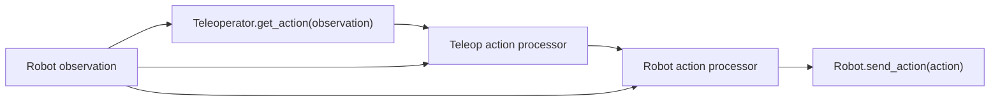

# Teleoperator architecture

A teleoperator reads an input device and returns its current action. Processors map that action into robot commands. The same interfaces are used by teleoperation, recording, and rollout.

## Control flow

Each control tick reads the robot observation, passes it to the teleoperator, and processes the resulting action before sending it to the robot:



`get_action(observation=None)` receives the raw robot observation. Devices that do not need robot state may ignore it; all implementations must accept the argument and leave the observation unchanged. `send_feedback()` commands the input device, such as moving a leader arm during handover.

## Responsibilities

| Component                                                                      | Responsibility                                                                                                                                               |
| ------------------------------------------------------------------------------ | ------------------------------------------------------------------------------------------------------------------------------------------------------------ |
| [`Teleoperator`](teleoperator.py)                                              | Device input, connection, calibration, and feedback.                                                                                                         |
| [`CompositeTeleoperator`](composite.py)                                        | Combine child actions with explicit prefixes, reject name collisions, and route feedback and lifecycle calls. Observations retain the robot's original keys. |
| [`KeyboardToBaseActionProcessorStep`](../processor/keyboard_base_processor.py) | Convert pressed keys into `x.vel` / `y.vel` (m/s) and `theta.vel` (deg/s), preserving numeric arm commands.                                                  |
| [`HoldUncommandedJointsProcessorStep`](../processor/hold_joints_processor.py)  | Fill missing joint targets from measured positions and hold them until reset or an explicit command.                                                         |
| [`make_mobile_teleop`](../common/teleop_setup.py)                              | Assemble the devices and action pipeline once per session.                                                                                                   |

## Mobile base with an optional leader

Keyboard-only control uses `KeyboardTeleop` directly. With a leader, a composite combines the keyboard and arm inputs; the setup helper uses the robot's `arm_action_prefix` when present. Mapping and joint holding remain in the action pipeline.

After constructing `robot`, `keyboard`, and an optional `leader` (`None` for base-only control):

```python
from lerobot.common.teleop_setup import make_mobile_teleop

teleop, action_processor = make_mobile_teleop(robot, base=keyboard, arm=leader)
```

Connect the robot and the returned teleoperator before running the control loop. Reuse the same action processor across recording and reset phases so speed selection and held joint targets persist. Reset the pipeline for a new session or reconnection. When an explicitly commanded joint becomes uncommanded again, its current measured position becomes the new hold target.

The helper adds keyboard mapping only for a standard keyboard; base devices that already emit robot actions pass through without that mapping. Set `hold_uncommanded=False` to omit joint holding where incomplete actions are supported. Recording keeps holding enabled for complete action frames.

See the [LeKiwi teleoperation](../../../examples/lekiwi/teleoperate.py) and [recording](../../../examples/lekiwi/record.py) examples for connection, processing, and cleanup.
